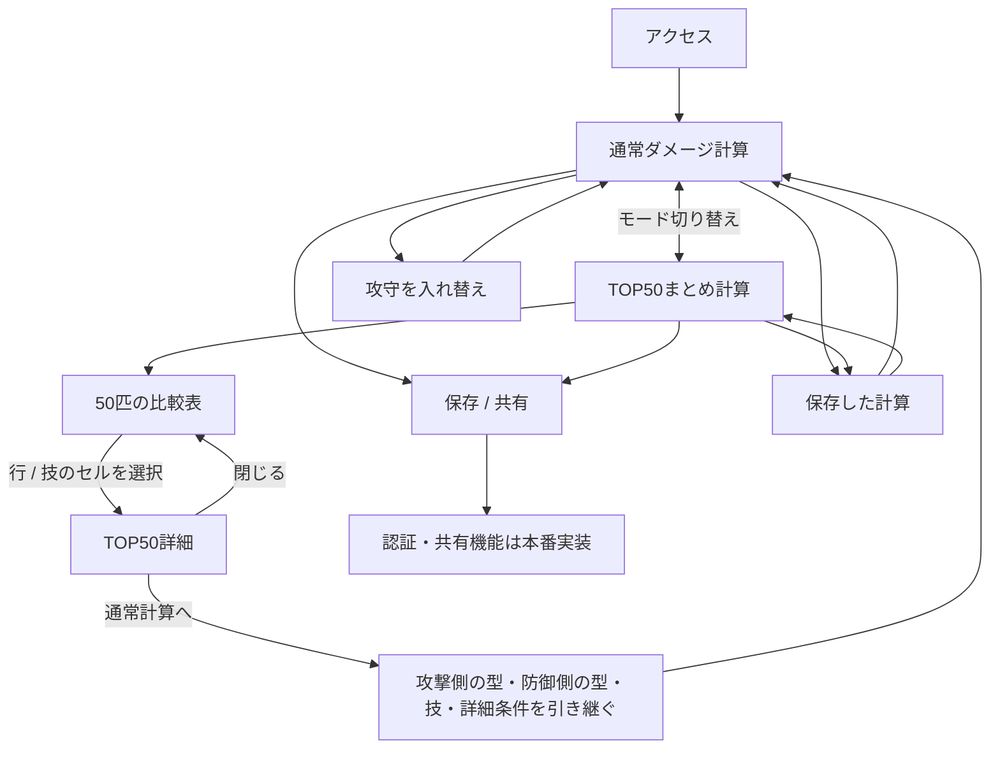
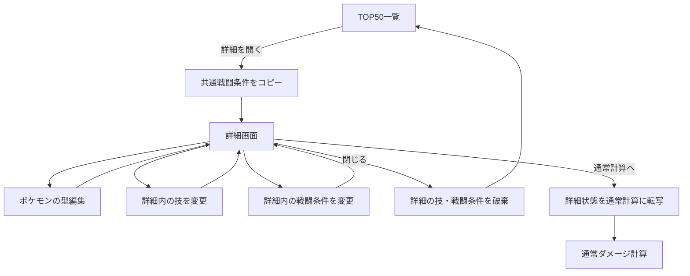
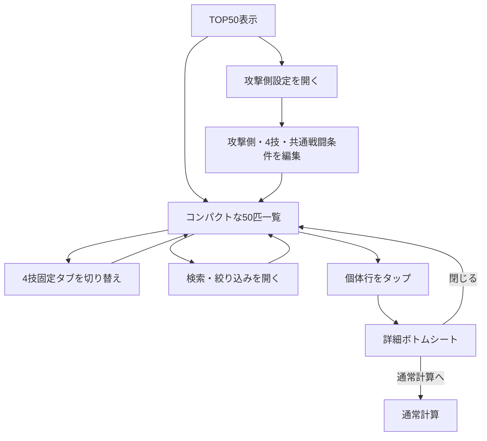
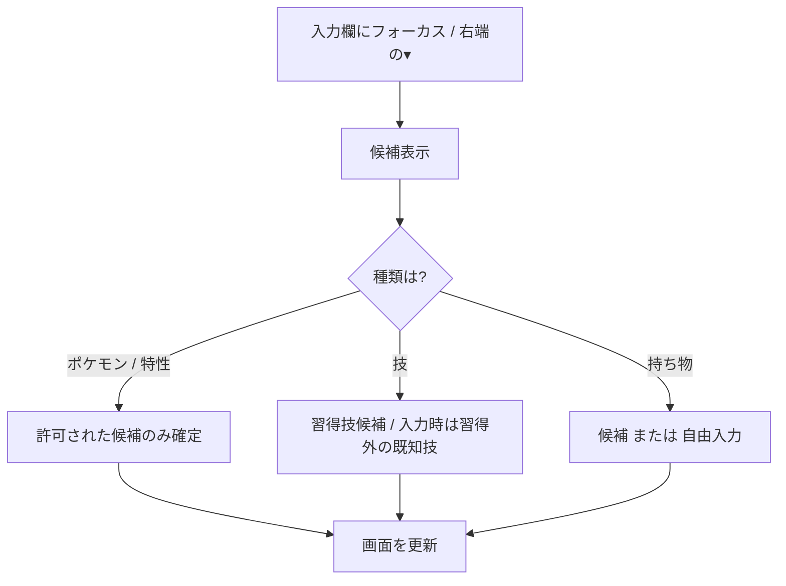

# ChampionCalc 画面遷移図 v0.5

## 1. 画面間遷移

## 2. TOP50詳細の状態遷移

**編集状態に関する例外**：TOP50詳細で変更した防御側のポケモンの型は、一覧のその個体のカスタム型として保持する。一時的なのは詳細内の技と戦闘条件。通常計算に遷移した場合は、その技と戦闘条件も引き継ぐ。

## 3. スマホのTOP50操作

## 4. 入力コンポーネントの状態遷移

## 5. 画面上の名称変更

- `乱数・確率詳細` → `詳細`
- `最短撃破` を撤去
- `16通りの乱数`、独立した `撃破判定` 項目を詳細から撤去
- `周囲のポケモンを攻撃する範囲技` → `範囲技`
- `型を編集` は独立操作として設けず、詳細画面内の編集フォームに統合
