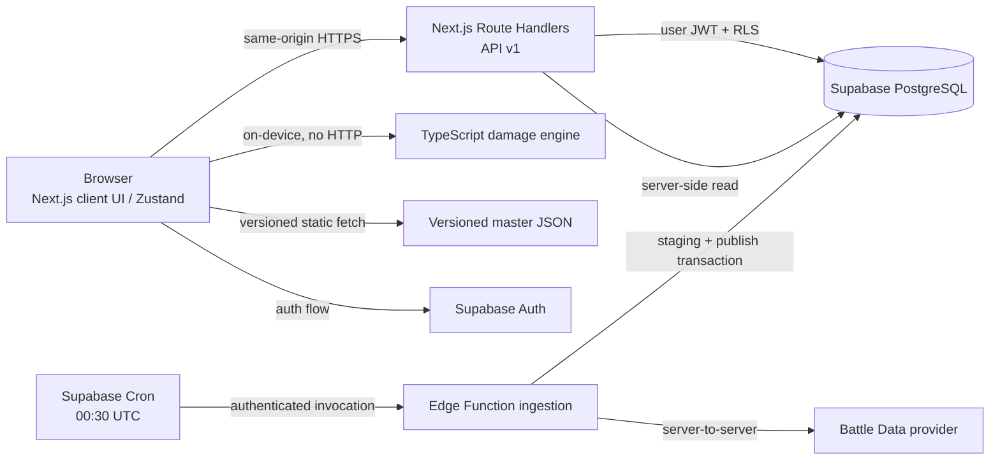
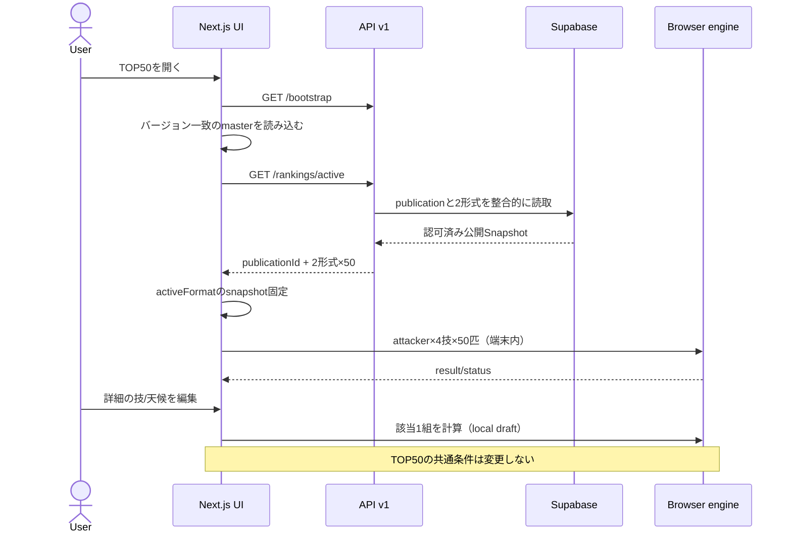

# API・データ連携詳細設計 v1.0

作成日: 2026-10-23 / 設計のみ / Codex向けドラフト

## 1. 目的と契約の優先順位

確定UI v0.5とReact状態管理v1.0の要求を、Next.js・Supabase・外部統計取得に変換する。ここで定義するのは**本アプリ用BFFの契約**であり、外部データの再配布サービスは提供しない。

競合時の優先順位: ① ユーザーが確定した要求とUI操作 ② 本書のAPI境界・失敗時挙動 ③ フロント状態管理v1.0 ④ DB設計v1.0＋補足v1.1 ⑤ 既存試作コード。ゲームの計算ルールはダメージエンジン詳細設計v1.2を参照し、未検証の計算を本書で確定させない。

## 2. システム境界



**データ所有権の分離**

| データ | 権威となる場所 | クライアントの振る舞い |
|---|---|---|
| ポケモン/技/特性/持ち物・効果/習得技 | バージョン付きアプリマスター | 読み取り専用、バージョンを固定 |
| TOP50順位・推定型 | `ranking_snapshots` + `ranking_entries` + `representative_builds` | snapshotを読み込んだら編集中の自動差し替えはしない |
| 通常計算入力/ TOP50入力 | クライアント側セッションStore | 変更は即再計算、保存は明示操作 |
| TOP50個体別の型override | クライアント側セッションStore | その`rankingEntryId`のみに反映 |
| TOP50詳細の技・戦闘条件 | 詳細コンポーネントのlocal reducer | 閉じると破棄、通常計算への転写時のみコピー |
| 計算結果/確定数/KO確率 | 計算エンジンが導出 | DBに入力の正として保存しない |
| 保存済み条件 | Supabase `saved_calculations` | ログインユーザー本人だけが読書き |
| 共有条件 | Supabase `shared_calculations` | 高エントロピートークンで匿名閲覧、編集不可 |

## 3. 通信・ルーティング方針

- フロントから外部統計APIを直接呼ばない（出典・キャッシュ・検証・ID正規化をサーバーへ集約）。
- Next.js **Route Handlers** の同一オリジン `/api/v1/**` を使用。通信JSONは`application/json; charset=utf-8`。
- APIのフィールドは**camelCase**。DBは**snake_case**。外部APIのフィールド名はAdapterだけが知る。
- 読取APIは二重取得を抑えられるものだけ`ETag`・`If-None-Match`を扱う。保存・共有の個人データは常に`Cache-Control: private, no-store`。
- 公開ランキング/マスターはアプリで必要なデータだけ返し、元JSON・カテゴリ統計全量を透過配信する汎用エンドポイントは設けない。
- APIは`requestId`（ログ・相関ID）を返し、認証トークン・共有トークン・外部プロバイダーの生データはログに残さない。
- `apiVersion` は `v1`。後方非互換変更は新versionで行い、保存payloadは`payloadSchemaVersion`を別途管理。

## 4. エンドポイント一覧と認可

| Method | Path | 目的 | 認証 |
|---|---|---|---|
| GET | `/api/v1/bootstrap` | 現在の出版単位、ルール/マスター版、静的ファイルURL、機能フラグ | 不要 |
| GET | `/api/v1/rankings/active` | 同一publicationのシングル・ダブルTOP50を1レスポンスで取得 | 不要 |
| GET | `/api/v1/rankings/snapshots/{snapshotId}` | 現行セッション・保存条件の参照用snapshotを取得（保持期間内・公開可のみ） | 不要 |
| GET | `/api/v1/calculations` | 自分の保存一覧（メタ情報のみ、ページング） | 必須 |
| POST | `/api/v1/calculations` | 計算設定を新規保存 | 必須 |
| GET | `/api/v1/calculations/{id}` | 自分の保存条件を取得 | 必須 |
| PUT | `/api/v1/calculations/{id}` | revision前提で保存条件を置換 | 必須 |
| DELETE | `/api/v1/calculations/{id}` | 自分の保存条件を削除 | 必須 |
| POST | `/api/v1/shares` | 計算設定の共有スナップショット生成 | 必須（推奨案） |
| GET | `/api/v1/shares/{token}` | 共有設定の匿名閲覧 | 不要 |
| DELETE | `/api/v1/shares/by-id/{id}` | 自分が作った共有リンクを失効 | 必須 |
| INTERNAL | `Supabase Edge Function: ingest-top50` | Cron専用の外部統計取得・検証・公開 | **内部認証のみ** |

**補足:** ランキングを取得できないときでも通常計算は利用できる。ダメージ計算HTTP API、ユーザーから起動するランキング再取得API、外部JSON全件を返す汎用APIは作らない。

## 5. 公開ランキングAPI

### 5.1 GET `/api/v1/bootstrap`

`200`例（値・URLは契約説明用のダミー）:

```json
{
  "data": {
    "apiVersion": "v1",
    "payloadSchemaVersion": 1,
    "sourceVersions": {
      "ruleVersion": "champions-rules-001",
      "masterDataVersion": "master-001",
      "effectCatalogVersion": "effects-001",
      "regulationId": "regulation-example"
    },
    "masterManifestUrl": "/assets/master/master-001/manifest.json",
    "activePublicationId": "example-publication-id",
    "rankingAvailability": "available"
  },
  "meta": { "requestId": "example-request" }
}
```

`rankingAvailability`: `available` / `unverified` / `unavailable`。UIは未検証ランキングをゲーム内の確認済みTOP50として表示しない。

### 5.2 GET `/api/v1/rankings/active`

- バックエンドは**同じpublication世代に属する2形式を同一読み取り単位で返す**。APIを別形式で二度呼んで世代をずらさない。
- 1件の防御候補は`rankingEntryId`、`pokemonFormId`、`rank`、`usageRate|null`、`representativeBuild`、`buildOrigin`、`warnings`を持つ。
- 統計未提供時は`usageRate:null`、不確実な値を0へ変換しない。
- APIには`publisherGeneratedAt`（提供元のデータ生成日時）, `fetchedAt`, `publishedAt`, `regulationId`, `sourceId`, `rankingProvenance`, `verificationStatus`, `attribution`を含める。
- キャッシュは短期のアプリ表示用途のみ。想定は`public, max-age=60`を初期値（上限は提供元の規約を優先し、本番設定前に確認）。`ETag`はpublication ID＋内容hashで構成する。
- 50件未満、フォームID未解決、検証不十分の場合は**成功に見せかけた欠損50件を返さない**。有効な旧世代があるならそちらを表示する。
- DB上に有効publicationがない場合は`503 RANKING_NOT_READY`。UIはTOP50部分のみ失敗画面とし、通常計算を維持する。

レスポンスの縮約例（50件×2形式のうち先頭1件だけを**説明用**に表記）:

```json
{
  "data": {
    "publicationId": "pub-example",
    "publishedAt": "2026-10-22T00:30:00Z",
    "rankings": {
      "singles": {
        "snapshotId": "snapshot-s",
        "regulationId": "regulation-example",
        "sourceId": "battle-data",
        "sourceGeneratedAt": "2026-10-22T08:44:17.447Z",
        "fetchedAt": "2026-10-23T00:30:00Z",
        "verificationStatus": "verified_ingame",
        "rankingProvenance": "ingame_rank",
        "attribution": {"label":"Battle data provided by Pokémon Champions Battle Data","url":"https://championsbattledata.com/"},
        "entries": [
          {
            "rankingEntryId":"snapshot-s:r1",
            "rank":1,
            "pokemonFormId":"form-example",
            "usageRate":null,
            "buildOrigin":"estimated",
            "representativeBuild": {"pokemonFormId":"form-example","abilityId":"ability-example","item":{"kind":"known","itemId":"item-example"},"natureId":"nature-example","statPoints":{"hp":2,"attack":32,"defense":0,"spAttack":0,"spDefense":0,"speed":32}},
            "warnings":[]
          }
        ]
      },
      "doubles": {"snapshotId":"snapshot-d","regulationId":"regulation-example","sourceId":"battle-data","sourceGeneratedAt":null,"fetchedAt":"2026-10-23T00:30:00Z","verificationStatus":"verified_ingame","rankingProvenance":"ingame_rank","attribution":{"label":"Battle data provided by Pokémon Champions Battle Data","url":"https://championsbattledata.com/"},"entries":[]}
    }
  },
  "meta": {"requestId":"example-request"}
}
```

**この例の`verificationStatus`はAPI形式を説明する架空値であり、実際の提供元がゲーム内一致を検証済みという意味ではない。** 正式応答では`singles`,`doubles`各50件が必須。

### 5.3 GET `/api/v1/rankings/snapshots/{snapshotId}`

- セッション固定、保存・共有の復元でのみ使用。閲覧可能な`published/retained`のみ。
- 公開から除外・削除済みは`410 SNAPSHOT_EXPIRED`。存在しないIDは`404`。
- スナップショットを別形式へ流用しない。レスポンスに`format`・`sourceVersions`を含め、要求した計算の形式と一致することを検証。
- 過去Snapshotを無期限保持する設計にはしない。データ保存期間と共有の再現保証についてはライセンスに照らして最終決定する。

## 6. マスターデータ連携

マスターは **版付き静的資産**として配信する。例:

- `/assets/master/{masterDataVersion}/manifest.json`
- `/assets/master/{masterDataVersion}/pokemon-forms.json`
- `/assets/master/{masterDataVersion}/moves.json`
- `/assets/master/{masterDataVersion}/abilities-items.json`
- `/assets/master/{masterDataVersion}/learnsets.json`

manifestに各ファイルの`sha256`、`schemaVersion`、`regulationId`、対象フォーム/技件数と`ruleVersion`・`effectCatalogVersion`を記載。内容と版が一致しない場合は**計算を開始しない**。非互換版を混在させない。どの項目が参照技の物理・特殊、効果確率、習得技、特性候補なのかを表示側で推測しない。

静的アセットの出典・ゲームデータの利用条件は本番配信前に確認すること（候補Battle Dataだけでは網羅的なマスターの出典が確定しない）。

## 7. 保存・共有・認証の契約（概要）

- **認証:** Supabase Auth SSR cookie、保護routeで信頼できるclaims/Userを検証。Cookie内の未検証のsessionオブジェクトだけを認可に使用しない。
- **保存:** input snapshotだけを保存。クライアントが送った`ownerId`、ダメージ値、撃破確率を信用せず、不要なフィールドは拒否または除去。`title`は1〜100文字。
- **更新:** `If-Match: "rev:<number>"` を要求。成功でrevisionを1増やす。古いrevisionなら`409 REVISION_CONFLICT`と現在revisionを返す。`If-Match`欠落は`428 PRECONDITION_REQUIRED`。
- **共有:** ログインした作成者が、現在の合法な条件のスナップショットを作る。URLのトークンは安全な乱数（32バイト推奨）とし、DBにはhashのみ保管。閲覧は匿名可、編集は元データへ反映しない。
- **リンクの寿命:** 有効期限のUXと規定デフォルトは未確定。失効・期限切れは`410 SHARE_EXPIRED`を返す。ランキング由来の元統計全量は共有payloadへコピーしない。
- **同期待ち:** 複数端末の同時編集は自動上書きせず、競合ダイアログから再読み込み/別名保存を選べるようにする。

詳しくは`auth-save-share-design-v1.0.md`を参照。

## 8. HTTPエラー契約

成功: `{ "data": ..., "meta": { "requestId": "..." } }`

失敗: `{ "error": { "code": "...", "message": "...", "requestId": "...", "details": {} } }`

`details`にはユーザーへ安全なフィールドの不足・重複・版不整合のみを含め、SQL文、トークン、内部stack、外部プロバイダーのレスポンス全体を含めない。

| Status | code | 例 |
|---|---|---|
| 400 | `INVALID_REQUEST` | クエリ・ID形式不正 |
| 401 | `AUTH_REQUIRED` | 未ログイン保存 |
| 403 | `FORBIDDEN` | 認可不足（存在有無を伏せる場合は404） |
| 404 | `NOT_FOUND` | 自分に見えない保存ID |
| 409 | `REVISION_CONFLICT` | 端末間の保存競合 |
| 410 | `SNAPSHOT_EXPIRED`, `SHARE_EXPIRED` | スナップショット/リンク失効 |
| 413 | `PAYLOAD_TOO_LARGE` | サイズ上限超過 |
| 422 | `VALIDATION_FAILED`, `VERSION_INCOMPATIBLE` | 能力ポイント、版、必須項目の不正 |
| 428 | `PRECONDITION_REQUIRED` | 保存更新で`If-Match`なし |
| 429 | `RATE_LIMITED` | 共有発行回数等を超過 |
| 503 | `RANKING_NOT_READY` | 有効な公開順位なし |
| 500 | `INTERNAL_ERROR` | 想定外 |

**計算エンジンの** `ok/nonDamaging/missingContext/unsupported/invalid` はAPIのHTTP状態ではない。クライアント内部の結果型として表示する。

## 9. 順序と障害分離



障害時の表示:
- マスター破損: 計算停止、更新・再読込の導線を提示。
- API更新失敗: 公開中の旧Snapshotがあれば継続。`sourceGeneratedAt`と`fetchedAt`を混同しない。
- ランキング全体不可: TOP50のみ取得失敗、通常計算を残す。
- 1匹の計算が`unsupported`: そのセルだけ警告表示。全200件を一律失敗にしない。
- 保存不可: 編集中のZustandセッションは保持し、リトライで二重登録しないためIdempotency-Keyを付す。

## 10. 互換性・ID写像

- frontend `rankingEntryId`はDBの `(snapshot_id, rank)` から**`${snapshotId}:r${rank}`**を決定的に生成（DBに新たなUUID列を要求しない）。順位だけ、名前だけではキーにしない。
- DB `representative_builds.build_kind='observed'` → API `buildOrigin='measured'`; `'estimated'` → `'estimated'`; `'incomplete'`→`'incomplete'`。frontendの`custom`はユーザー上書き状態であって外部統計に存在しない。
- API `payloadSchemaVersion: number`（初期 `1`）。フロント既存参考型の`SourceVersions.schemaVersion: string`と混同しない。Adapterで明示変換し、実装時に型を統一する（後述の設計差分）。
- 既存DB保存JSONの`calculation_payload`はスキーマ検証済み入力のみにする。失敗中ドラフト・詳細local reducer・KO表示文字列は保存しない。
- 最新公開Snapshotに切り替わっても、開いているTOP50セッションは変更しない。手動「新データを使う」操作で新Sessionを作り、旧overrideを黙ってコピーしない。

## 11. 非機能・観測要件（暫定）

- 読取APIの目標: キャッシュ済みランキングp95 500ms以内、保存/共有のp95 1秒以内（**暫定目標、計測して確定**）。200組計算の3秒以内はブラウザ側の別SLO。
- レート制限: 共有作成など書込みに適用。閾値は公開時トラフィックを測って決定。
- アクセスログ: requestId、status、duration、route、publicationId、同期結果、エラーcode。認証Cookie/URL共有token/メール/育成型全文を記録しない。
- 提供元の出典リンクと非公式表記をTOP50画面に表示する。利用条件に合致しない統計の長期保存・全量再配信をしない。
- Version互換性: payloadに`payloadSchemaVersion`、`sourceVersions`、snapshotIdを持たせる。既知でないrule/masterは再現不能と明記し、黙って現行値で再計算しない。

## 12. 関連資料

- フロント状態: `champions-frontend-design-v1.0/docs/frontend-state-design-v1.0.md`
- DB詳細: `champions-data-design-v1.0/docs/database-design-v1.0.md`
- DB差分: `champions-api-validation-v1.1/docs/database-amendments-v1.1.md`
- 計算エンジン: `champions-design-damage-v1.2/docs/damage-engine-detailed-design-v1.2.md`
- Supabase Auth/RLS/Cronの公式仕様はREADME記載のURLを参照。
