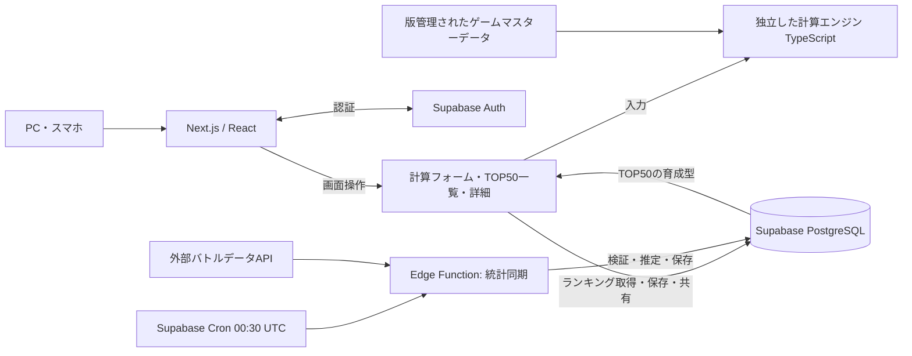
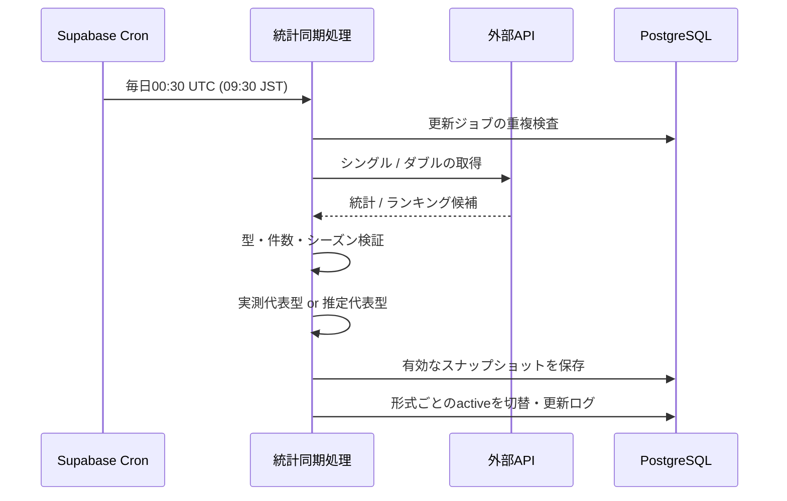
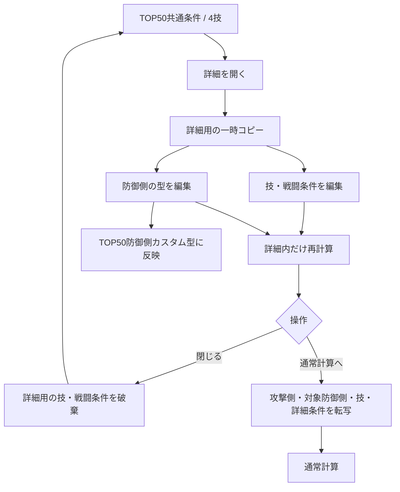

# Pokémon Champions ダメージ計算アプリ — 技術スタック・アーキテクチャ設計書 v1.0

- 作成日: 2026-10-23
- 状態: **技術構成の推奨案（実装前の技術検証あり）**
- 前提: 要件定義 v0.3 / 確定UI v0.5 / 2モード（通常計算・TOP50まとめ計算）
- GitHub上の推奨配置: `docs/architecture-v1.0.md`

## 1. ゴールと設計原則

### ゴール
- PC/スマホで快適に使えるWebアプリを構築する。
- 最大4技×50匹=200組を素早く再計算する。
- Pokémon Championsに固有のルールを検証可能な形で実装する。
- 統計情報を毎日**09:30 JSTに1回**取得し、安定したスナップショットを配信する。
- 匿名で計算可能、アカウントで保存・同期可能、共有URLで条件を再現可能にする。

### 原則
1. **計算エンジンは独立した純粋なTypeScriptモジュール**とし、UIにもDBにも依存しない。
2. **計算はブラウザ内**で実行し、初期読み込み以外は原則サーバー往復不要とする。
3. **統計データとマスターデータを別管理**。外部データが不達でも通常計算は利用できる。
4. 計算結果は必ず、入力・適用ルール・データのバージョンを示せるようにする。
5. **UI v0.5を仕様上の基準**とし、簡潔な一覧と詳細内の一時編集の区別を守る。
6. 未取得データや未実装特殊効果を、確定した正確な数値として表示しない。

## 2. 採用スタック（推奨）

| レイヤー | 技術 | 用途／採用理由 |
|---|---|---|
| Web | Next.js（App Router） + React | ルーティング、初期データ表示、共有URL、編集UI |
| 言語 | TypeScript（strict） | 計算条件・型・特殊効果を型で表現 |
| UI | Tailwind CSS + shadcn/ui | UI v0.5再現、Combobox / Drawer / Dialog |
| フォーム | React Hook Form + Zod（必要なフォームで採用） | 編集値の検証・正規化 |
| 共有状態 | Zustand（編集セッション） | 通常計算・TOP50と詳細の状態分離 |
| データ取得 | サーバーコンポーネント／必要に応じTanStack Query | 初期表示・更新データ取得・再取得 |
| DB | Supabase PostgreSQL | TOP50スナップショット、推定代表型、保存・共有 |
| 認証 | Supabase Auth | ログイン、ユーザー単位の保存と同期 |
| 定期ジョブ | Supabase Cron + Edge Function | 09:30 JSTの1回更新、外部データ取得・変換・保存 |
| 公開 | Vercel | Next.js配信・プレビュー環境 |
| テスト | Vitest + Playwright + DB RLSテスト | 計算・画面遷移・セキュリティ検証 |
| 管理 | pnpm | 共通計算パッケージとWebアプリを同一リポジトリで管理 |

> バージョン番号は実装開始時に安定版を選びロックファイルで固定する。上記はアーキテクチャ上の選択であり、アカウントやインフラの作成・デプロイはまだ行っていない。

## 3. 構成図



**設計上の注意**: この図は論理構成。ブラウザからDBへアクセスするときは認可付きSupabase APIを利用し、公開してはいけない情報はサーバー側で扱う。公開統計は公開用の最小限の読み取りスキーマに限定する。

## 4. フロントエンドと計算エンジン

### 4.1 計算はクライアントで実行
- 初期表示で必要なポケモン・技・特性・持ち物のマスターデータを読み込む（データ版を保持）。
- 入力検証が通ったら `calculateDamage(input, ruleset)` を呼ぶ。
- TOP50では同じ関数を4技×50匹に適用する。
- 設定変更による再計算は、変更された要素だけを更新する。処理が重くなるケースはWeb Workerに切り出せる構成にしておく。
- 重要な計算結果はテストケースで検証し、**未対応の処理は警告し、確定値のように表示しない**。

### 4.2 計算エンジンが扱うモデル

```ts
type BattleFormat = 'singles' | 'doubles';
type Stat = 'hp' | 'atk' | 'def' | 'spa' | 'spd' | 'spe';

type PokemonBuild = {
  pokemonId: string;
  formId?: string;
  abilityId: string;
  itemId?: string;
  itemCustomText?: string;
  statPoints: Partial<Record<Stat, number>>;
  natureModifiers: Partial<Record<Exclude<Stat, 'hp'>, 0.9 | 1.0 | 1.1>>;
  currentHp?: number;
  stages: Partial<Record<Exclude<Stat, 'hp'>, number>>;
};

type BattleContext = {
  format: BattleFormat;
  weather: string;
  terrain: string;
  spreadHitsMultipleTargets: boolean;
  conditions: Record<string, boolean | number | string>;
};

type CalculationInput = {
  attacker: PokemonBuild;
  defender: PokemonBuild;
  moveId: string;
  context: BattleContext;
  rulesVersion: string;
};

type CalculationResult = {
  status: 'ok' | 'invalid-input' | 'unsupported-effect';
  damageRolls?: number[]; // 通常は16乱数。固定値技などは別の取り扱いも可
  minDamage?: number;
  maxDamage?: number;
  minDamagePercent?: number;
  maxDamagePercent?: number;
  remainingHpRange?: [number, number];
  ko?: { hits: number; probability: number; guaranteed: boolean };
  warnings: string[];
};
```

この型はインターフェースの**設計例**。実際は技固有条件を識別可能な型（discriminated union）にし、効果の実装とともに詳細化する。

### 4.3 UI v0.5との整合性
- UIは攻撃側で攻撃/特攻、防御側でHP＋防御/特防を基本表示する。
- ただしダメージに素早さなどの隠れた能力が必要な特殊技があるため、エンジン内部では6能力を保持し、不足した前提を勝手に捏造しない。
- ポイント変更→実数値再計算。実数値変更→合法なポイントを探索。成立しなければポイントを `?` と表示し**計算を未確定扱い**にする。
- 技・ポケモンの入力候補はデータに基づく。特性はポケモン固有候補限定。技は習得外の**存在する技**を手入力から選べる。持ち物は自由入力できるが、効果が不明なら警告を出す。
- 技・特性・持ち物の効果説明と追加効果率はマスターデータで管理する。`30%でひるみ` のように表示する。
- 攻守入れ替えはフォームの2つのビルドを交換し、技候補との整合性を再検証する。

### 4.4 撃破確率の扱い
- ダメージ乱数に基づく複数回攻撃の撃破確率を算出し `乱数n発(XX.X%)` または `確定n発` と表記する。
- `3発以上` は**フィルター名のみ**で許容し、実際の結果は正確な n を表示する。
- 無効技／ダメージ0しか出ない技は `撃破不可`、未対応効果は `未対応` とする。任意のnで表現をごまかさない。
- 命中率・急所・回復・スリップ等を含む複数ターンの確率は、モデルの適用範囲を明示し、単純なダメージ乱数による確率と混同しない。
- 一覧では詳細な16値を表示しない。計算エンジンは内部保持してよい。

## 5. TOP50データ同期

### 5.1 更新処理



- Cron式（**UTC基準**）：`30 0 * * *`。日本時間で毎日09:30に該当（JSTは夏時間なし）。
- この時刻は**ジョブ起動予定時刻**。外部データの公開が09:30に確実に終わっている保証ではない。
- 1日の更新試行は1回とし、アプリレベルで自動再試行しない。ジョブの冪等性を保ち、重複起動で二重更新しない。
- シングル／ダブルそれぞれ、有効なデータが揃った場合のみactiveスナップショットを切り替える。
- 失敗時は前回の正常データを利用し、チェック実行時刻・元データ更新日時・失敗理由を別々に記録する。
- 取得時のシークレットはSupabase Vault等の安全な領域に格納し、クライアントへ露出しない。

### 5.2 外部API接続
- **第一候補**: Pokémon Champions Battle Data API (`https://championsbattledata.com/api_guide`)。
- 公開APIには`/api`・`/api/pokemon/:name`・`/api/battle/:format/:name`があり、シングル・ダブルの個体別の技・持ち物・性格・配分・特性などを取得できる。
- **重要な未検証事項**: 正確なゲーム内の「使用率TOP50順位」をAPIから一括取得できるかは公開仕様からは確定していない。インデックスから順位を導出できるかを実データで先に試す。
- **重要な未検証事項**: 能力ポイント・性格・特性・持ち物の「同時採用構成」が得られるか未確認。なければ統計を元に`推定代表型`を作る。
- ランキングの**順位**と**使用率%**は別物。元データに実数の使用率%がなければ表示しない。
- API停止・変更・利用条件改定を想定してアダプタ層を設ける。
- 利用条件上、明確な帰属表示を行い、適切なキャッシュに限定する。生データの再配布・永久ミラーは行わない。

### 5.3 代表型の生成
1. 完全な組み合わせ統計があれば`measured`として採用。
2. なければ公開された採用率上位の配分・性格・特性・持ち物から合法な構成を選び`estimated`として保存。
3. 不足・矛盾したデータは`incomplete`として表示し、ユーザーが修正できるようにする。
4. 出典・対象形式・シーズン・元データ時刻・推定アルゴリズム版を保持し、推定の確からしさを実測採用率と誤認させない。

## 6. TOP50詳細の一時状態と永続状態

UI v0.5で最も重要なデータフローは以下。



**状態分類**:
- `top50Global`: 形式、攻撃側の型、最大4技、共通条件、ranking snapshot ID。
- `defenderOverrides[pokemonId]`: 一覧で使う対象ごとのカスタム型。詳細を閉じても保持される（ユーザーが保存すればDBにも保存）。
- `detailDraft`: 開くたび生成する技・戦闘条件のコピー（破棄可能）。
- `normalCalculation`: 通常計算専用の独立した状態。
- `goToNormal(detailDraft)`: 対象の全条件を通常計算へ**一度だけコピー**してから遷移する。

**禁止**: 詳細の一時的な技や天候変更がTOP50の全50匹へ波及すること。

## 7. データベースの論理構造（詳細DDLは次工程）

| テーブル | 主要カラム／責務 |
|---|---|
| `pokemon` | 正規ID、表示名、フォルム、種族値、タイプ、版 |
| `pokemon_external_ids` | 正規ID ↔ Showdown等の外部ID |
| `moves` | 技ID、威力、分類、範囲、追加効果・発生率、対応版 |
| `learnsets` | ポケモンID、技ID、ルール・レギュレーション版 |
| `abilities` / `items` | 効果説明、効果コード、対応版 |
| `ranking_snapshots` | バトル形式、シーズン、ソース日時、取得日時、状態、出典 |
| `ranking_entries` | snapshot ID、順位、ポケモン／フォルムID、育成型ID |
| `usage_stat_summaries` | 必要な採用統計の要約／出典（原データ全件ミラーしない） |
| `representative_builds` | 配分、性格補正、特性、持ち物、`measured/estimated/incomplete`、根拠 |
| `users` | Supabase Authに紐づく公開しない補助設定（必要な場合のみ） |
| `saved_calculations` | 所有者、モード、条件JSON、rulesVersion、snapshot ID、改訂番号 |
| `shared_calculations` | 非推測的token、共有スナップショット、作成者、公開状態、任意失効 |
| `update_runs` | 日付/形式、結果、失敗理由、started/finished/sourceUpdatedAt |

### DBのルール
- `saved_calculations`は`owner_id`に対し**Row Level Security（RLS）**を有効化し、原則本人だけが閲覧・更新・削除できる。
- `shared_calculations`は個別の安全な公開読み取り導線のみを提供し、`users`等の情報を含めない。
- `service_role`鍵・Cron実行トークンはサーバーに限定する。
- `revision`または`updated_at`による楽観的競合制御を実装する。同時に編集された内容を無言で上書きしない。
- ポケモン・技・特性・持ち物の固定マスターはアプリの静的データとして版管理し、**必要に応じてDB参照**。初期からすべてをDBで毎回引く必要はない。

## 8. 保存・共有の方式

### 8.1 保存
1. 未ログインでも通常計算とTOP50計算は利用できる。
2. 保存時にログインしていなければ認証画面へ進み、入力中の状態を保持する。
3. `saved_calculations`に入力条件とデータ/ルールのバージョンを保存する。
4. 別の端末でログインすると同じ設定を取得する。

### 8.2 URL共有
1. 「共有」を押すと、その時点の**入力条件のスナップショット**を作る。
2. サーバーが十分な長さの推測困難な共有tokenを発行する（例: `/share/<token>`）。
3. 閲覧側はログインなしで共有された条件を再現できる。
4. 編集しても元の設定は更新されない。閲覧者が保存したければ自分のアカウントへ複製する。
5. 共有データに名前やアカウント情報等の非公開情報を含めない。
6. データ/ルールの版を紐づけ、古い版を厳密再現できない場合はその旨を明示する。

※ 認証プロバイダー（Googleログイン等）、共有リンクの期限と削除条件は次回の細部設計で確定する。

## 9. ルーティング案

| URL | 用途 |
|---|---|
| `/` | 通常ダメージ計算 |
| `/top50` | TOP50まとめ計算 |
| `/saved` | 保存した計算（認証必須） |
| `/login` | ログイン |
| `/share/[token]` | 共有された計算の表示と複製 |
| `/account` | アカウント設定（認証必須） |

TOP50の「詳細」は新しいURLの専用ページではなく、ページ内のDrawer / Sheetとして表示する（UI v0.5を維持）。

## 10. 推奨リポジトリ構成

```text
pokemon-champions-calc/
├── apps/
│   └── web/
│       ├── app/                    # Next.js App Router
│       │   ├── page.tsx            # 通常計算
│       │   ├── top50/page.tsx      # TOP50
│       │   ├── saved/page.tsx
│       │   ├── share/[token]/page.tsx
│       │   └── login/page.tsx
│       ├── components/
│       │   ├── calculator/
│       │   ├── top50/
│       │   ├── battle-conditions/
│       │   └── ui/
│       ├── features/
│       │   ├── calculation-state/
│       │   ├── ranking/
│       │   └── saved-calculations/
│       └── lib/
│           └── supabase/
├── packages/
│   ├── calc-core/                  # ゲーム計算エンジン（UI非依存）
│   ├── game-data/                  # ポケモン/技/特性/持ち物マスター
│   └── shared-types/               # API・保存形式の共通型
├── supabase/
│   ├── migrations/                # SQL・RLS・インデックス
│   ├── functions/sync-ranking/    # 日次取得ジョブ
│   └── tests/                     # RLS検証
├── docs/
│   ├── architecture-v1.0.md
│   ├── screen-design-v0.5.md
│   └── screen-flow-v0.5.md
├── tests/
│   └── e2e/
├── package.json
├── pnpm-workspace.yaml
└── pnpm-lock.yaml
```

プロジェクト名は**仮名**。リポジトリ名は実際に選択された名前へ置き換える。

## 11. 実装・検証順序

**Phase 0: 技術スパイク（優先）**
- APIのTOP50順位・フォルムID・性格／配分／特性／持ち物の取得可否を検証する。
- 公開ゲームマスターデータの正確性・利用条件を検証する。
- 計算式と端数処理の代表ケースを検証する。

**Phase 1: プロジェクト土台**
- Next.js + TS + Tailwind + shadcn/uiを初期化。
- v0.5をReactコンポーネントへ移植。ルーティング・状態管理・入力検証を実装。
- VitestとPlaywrightのCIを構築。

**Phase 2: ダメージ計算コア**
- ステータス計算・逆算、タイプ、補正順序、乱数、KO確率を実装。
- 特殊技・特性・持ち物は効果レジストリで拡張。未対応表記を必須にする。
- 既知ケースの正解データと突き合わせる。

**Phase 3: TOP50連携**
- 統計アダプタ・取得検証・推定代表型・アクティブスナップショットを実装。
- 一覧4技×50匹、詳細の一時条件、通常計算への転写を実装。
- 09:30ジョブと更新失敗時の保持・警告を実装。

**Phase 4: アカウント・共有**
- Supabase Auth、RLS、保存・同期・競合検出、URL共有を実装。
- 公開前に認可、保存/復元、レギュレーション違い等を検証する。

## 12. リリース受け入れ条件

- [ ] 4技×50匹をブラウザで計算し、目標3秒以内を代表端末で確認。
- [ ] 能力ポイント⇔実数値の双方向編集が正常で、成立しない入力では不正な計算値を出さない。
- [ ] TOP50詳細の技・条件は閉じれば破棄され、型の変更だけが一覧に残る。
- [ ] 詳細→通常計算で攻防・技・戦闘条件・育成型を引き継げる。
- [ ] 特殊効果の未対応を隠さず、計算精度テストが合格する。
- [ ] 09:30 JSTの更新ジョブが1日1回実行され、失敗時には旧データを保持する。
- [ ] ログインユーザーだけが自分の保存データを編集できる。
- [ ] 共有URLで同じ条件を復元でき、元の保存データを変更できない。
- [ ] PCとスマホで主要操作が完了する。

## 13. 未確定・実装前の判断事項

| 論点 | 現在の扱い | 決定時期 |
|---|---|---|
| 最新TOP50ランキングの正式取得方法 | **最優先検証**。外部APIのランキング一括取得は未確認 | Phase 0 |
| ゲームマスターデータの採用元・権利 | 複数ソースを検証して正式決定 | Phase 0 |
| 計算式の特殊処理一覧と検証データ | Champions実仕様で検証する | Phase 0〜2 |
| 認証プロバイダー | Supabase Authは採用、ログイン方式は未確定 | Phase 4設計前 |
| 共有リンクの期限・削除権限 | スナップショット方式を基本、詳細未確定 | Phase 4設計前 |
| 登録済み未対応技・自由入力持ち物 | 不明な効果を黙って無視しない | Phase 2 |

## 14. 参照（2026-10-23確認）

- Next.js App Router: https://nextjs.org/docs/app
- Next.js Testing: https://nextjs.org/docs/app/guides/testing
- Supabase Auth SSR: https://supabase.com/docs/guides/auth/server-side
- Supabase RLS: https://supabase.com/docs/guides/database/postgres/row-level-security
- Supabase Cron: https://supabase.com/docs/guides/cron
- Supabase Edge Functions scheduling: https://supabase.com/docs/guides/functions/schedule-functions
- Pokémon Champions Battle Data API Guide: https://championsbattledata.com/api_guide
- Pokémon Champions Battle Data API Rules: https://championsbattledata.com/api-rules/
- Vercel Cron Hobbyの精度制約（採用しない理由）: https://vercel.com/docs/cron-jobs/usage-and-pricing
- Championsダメージ計算式: https://champions.pokewiki.net/ダメージ計算式
