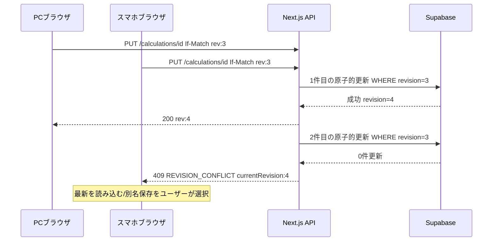

# 認証・保存・同期・共有 詳細設計 v1.0

## 1. 設計選択

- ダメージ計算は匿名で使用可。**サーバー保存・端末間同期・永続共有リンク発行はログイン必須**（この条件は推奨案で、UI最終レビューでユーザー承認が必要）。
- 共有URLを開いて閲覧・一時編集する操作はログイン不要。元の保存内容を変更しない。
- Supabase AuthのSSR cookieをNext.jsで管理。認可はサーバーで検証したclaims/ユーザーIDとPostgreSQL RLSの**両方**で守る。
- Cookie由来の未検証ユーザー情報、クライアントが送る`ownerId`、共有URLの主張を信用しない。
- エラー時にはクライアントの編集内容を保持し、失敗した保存を成功扱いしない。

## 2. 保存入力の不変条件

保存対象は`SavedInputSnapshot`（`normal`または`top50`）の**合法な入力のみ**:

- `payloadSchemaVersion`（初期1）、`mode`,`format`,`sourceVersions`, `attacker`, `moves`（1..4）、`conditions`。
- normalの場合は`defender`。
- top50の場合は`rankingSnapshotId`と`defenderOverrides: Record<rankingEntryId, ValidatedBuild>`。
- 参照フォーム、特性、技、マスター版が一致すること。
- フル6能力ポイント・性格ベクトル・HP/状態変化を内部では保持。UIに非表示の能力を削除しない。
- 逆算不能な実数値入力（UIに`?`）など`invalidDraft`は保存不可（422）。
- 未知の持ち物自由入力は存在を保持できるが、計算結果は別途`unsupported`とする。保存の合法性と計算可能性を区別する。
- TOP50詳細だけの技/戦闘条件は保存時にTOP50共通条件へ取り込まない（詳細から通常計算に明示的に遷移した時は転写先normalの状態になる）。
- ダメージ乱数・HPバー・確定数・KO確率は常にエンジンで導出し、保存入力として送らない。

## 3. 保存API契約

### `GET /api/v1/calculations?limit=20&cursor=...`
- 認証必須。自分の保存ID・title・mode・format・revision・updatedAtなど軽量メタ情報のみ。
- `limit`: 1〜50、初期20。`cursor`: opaque（単純offsetは禁止、`updated_at + id`による安定ページング）。
- ユーザーが保存したフルpayloadは一覧レスポンスに含めない。

### `POST /api/v1/calculations`

入力例（値は説明用）:

```json
{
  "title":"環境対策用",
  "snapshot": {
    "payloadSchemaVersion":1,
    "mode":"top50",
    "input": {
      "format":"singles",
      "rankingSnapshotId":"snapshot-example",
      "attacker": {"pokemonFormId":"form-example","abilityId":"ability-example","item":{"kind":"none"},"statPoints":{"hp":0,"attack":32,"defense":0,"spAttack":0,"spDefense":0,"speed":32},"natureFactors":{"attack":1.1,"defense":1,"spAttack":0.9,"spDefense":1,"speed":1},"currentHp":100,"stages":{}},
      "moves":["move-example"],
      "conditions":{"weather":"none","terrain":"none","flags":[]},
      "defenderOverrides":{},
      "sourceVersions":{"schemaVersion":"1","ruleVersion":"rules-example","masterDataVersion":"master-example","effectCatalogVersion":"effects-example","regulationId":"reg-example"}
    }
  }
}
```

**重要:** 上記は契約説明用の例であり、`PokemonBuildDraft`/`BattleContextDraft`サブ構造はまだ最終確定していない。正式な必須項目・enum・ID整合は型定義とZodスキーマを一箇所に統合して確定する。**このAPIではsnapshot直下の`payloadSchemaVersion:number`を正とする**。前工程のフロント参考型に残る`schemaVersion:string`は後方互換Adapterで移行し、同じpayloadで二重に持たない。説明用の構成は実際の合法性・現在のポケモン技を表さない。

- ヘッダー `Idempotency-Key: <UUIDv4>`（作成系は必須）。同じユーザー・同じキー・同じbodyでは同じ作成結果を返す。**同じキーで別body**は409 `IDEMPOTENCY_CONFLICT`。
- 正常時201、`Location: /api/v1/calculations/{id}`。`id`,`revision=1`,`createdAt`,`updatedAt`を返す。
- `owner_id`は認証ユーザーからのみ導出。クライアント指定を受け付けない。
- 保存時はsnapshot参照の存続・版互換をチェックし、期限外なら`410 SNAPSHOT_EXPIRED`。但し共有/保存の過去再現保証はライセンス確認で最終決定する。
- 25万バイトのDB制限に合わせ、アプリでは**250,000バイト以下**にバリデート。より厳しいAPI上限への変更は可能。

### `GET /api/v1/calculations/{id}`
- 本人だけ取得可。本人以外のIDは`404 NOT_FOUND`（存在情報を漏らさない）。
- `Cache-Control: private, no-store`。

### `PUT /api/v1/calculations/{id}`
- リソースをまるごと置換。`If-Match: "rev:7"`必須。
- DBでは所有者・ID・revision一致をひとつの条件として**原子的更新**。更新件数0なら、所有権確認後に404または409を返す。
- 更新成功でrevision=8と新しいtimestampを返す。
- 競合時は409 `REVISION_CONFLICT`と最新revisionを返す。クライアントが勝手に最後の書き込みを採用しない。
- 更新中の別タブ/別端末の競合: 「最新を読み込む」「今の設定を別名で保存」を提示する。自動マージは初期実装しない。

### `DELETE /api/v1/calculations/{id}`
- 本人だけ。204（応答bodyなし）。
- 既存`shared_calculations.source_calculation_id`は`SET NULL`のため、**保存元を削除しても共有リンクは残りうる**。共有の失効は別操作。

## 4. 共有リンク

### `POST /api/v1/shares`

- 認証必須（推奨設計）。未保存の計算を共有できるよう、**入力スナップショットを直接受け付ける**。保存済み計算を選んだ場合もサーバーで所有者と revision を検証し、共有時点の入力を複製。
- `Idempotency-Key`必須。実際のトークンを再表示する必要があるので、短期冪等性レコードの秘匿設計を明確化（トークン平文をDBへ無期限保管しない）。
- 32バイト以上のCSPRNGからURL安全なopaque tokenを生成。DBにはSHA-256 hashだけを保存。
- レスポンス201で`shareUrl`, `shareId`, `expiresAt|null`を作成者だけへ返す。生tokenは生成時のみ閲覧可能。
- 観測ログやアクセス解析にURLのtokenを送らない。ページの`Referrer-Policy: no-referrer`、共有画面は`robots: noindex`、`Cache-Control: no-store`を指定。

### `GET /api/v1/shares/{token}`
- ログイン不要で閲覧可能。tokenを検証し、失効・期限切れで410。存在しないtokenは404。
- 表示するのは公開が意図された計算入力・必要な版情報のみ。ownerId、メール、元保存タイトル（必要な場合を除く）、非公開メタ情報は返さない。
- 閲覧側で変更した条件は共有元に書かない。自分の計算として保存する際はログインし、独立コピーを作る。
- 過去のrule/masterが利用できなくなった場合は`VERSION_INCOMPATIBLE`または`SNAPSHOT_EXPIRED`として**再現できない理由を表示**。現行条件へ勝手に置換しない。

### `DELETE /api/v1/shares/by-id/{id}`
- 作成者だけが明示失効できる。204。共有tokenを削除要求に使わない。

### 推奨URL

`https://<app-host>/share/<opaqueToken>`。共通の共有閲覧画面を表示し、Serverはtokenをハッシュ化して照会。

**注意:** URLそのものを「知っている人全員がアクセスできる」仕様。プライベートな情報を混ぜない説明を作成時に表示する。

## 5. 認可境界とRLS

| 機能 | DB利用権限 | RLS/追加処理 |
|---|---|---|
| ログインユーザーの保存 | ユーザーJWTを使うDBクライアント | `saved_calculations.owner_id = auth.uid()` + 最小GRANT |
| 公開ランキング読取 | 信頼済みServerルート（公開用DTOに整形） | 内部集計全件を直接公開しない |
| 共有リンク閲覧 | 信頼済みServerルートの限定アクセス | hash照合・期限/失効検証・最小DTO。クライアントからshared tableの直接SELECT禁止 |
| ランキング更新 | 内部Edge Function専用資格情報 | 必要な管理権限だけでDBへ書込み。外部から直接起動不可 |
| Master公開 | 版付き読み取り専用静的アセット | サーバーの完全性チェック・配信許諾を確認 |

- Supabaseでは**GRANT + RLSの両方**が必要。ポリシーがあることと、一般ロールに適切な権限しかないことを検証する。
- `service_role`等の権限はRLSをバイパスし得る。個人保存の認可に安易に使用しない。
- 機微情報を公開する可能性のあるDB views/security definer関数の権限も監査する。
- CSRF/Origin対策: Cookieを使う状態変更ルートはOrigin検証、SameSite設定、CSRF対策を実施。XSS対策とCSPを設計する。
- 認証のSDK選定は実装時の公式ドキュメントに追随し、Next.jsのSSR cookieとPKCEの公式フローを基本とする。

## 6. レースコンディションと保存の一貫性



## 7. 共有の再現性と外部APIの利用条件の衝突

- 「同じ条件・同じ版で再計算」と「統計の永久ミラー禁止」を両立する必要がある。
- 保存/共有の入力には**参照snapshotId + 入力型 + 明示override + 必要最小限の出典/ルール版**を含める。統計のraw全量は複製しない。
- 元Snapshotが規約に従って削除済みの場合、元型を完全再現できないことがある。データ提供元の利用許諾を確認して、最小限の派生型保存が許されるか判断する。
- 代替方式: 「共有時点に選択された一匹の型だけを入力スナップショットへ固定」「ランキングは現在のTOP50で再構成するが、過去と異なる旨を警告」「共有有効期間とSnapshot保持期間を一致させる」。最終方式は**次工程で確定**。

## 8. テスト観点

- 未ログインで通常計算/共有閲覧ができ、保存・共有作成が401になる。
- ユーザーAの保存IDをBが取得/更新/削除できない。RLS、GRANT、APIの多層テストを実行。
- 競合時は409で片方の保存が保護される。
- 保存内容にKOラベル、ダメージ結果、詳細local条件、不要なユーザーメタが混入しない。
- 共有URLから元ユーザーの他の保存データを列挙できない。
- 期限切れ/失効を410で扱い、cookieやURL tokenをログに記録しない。
