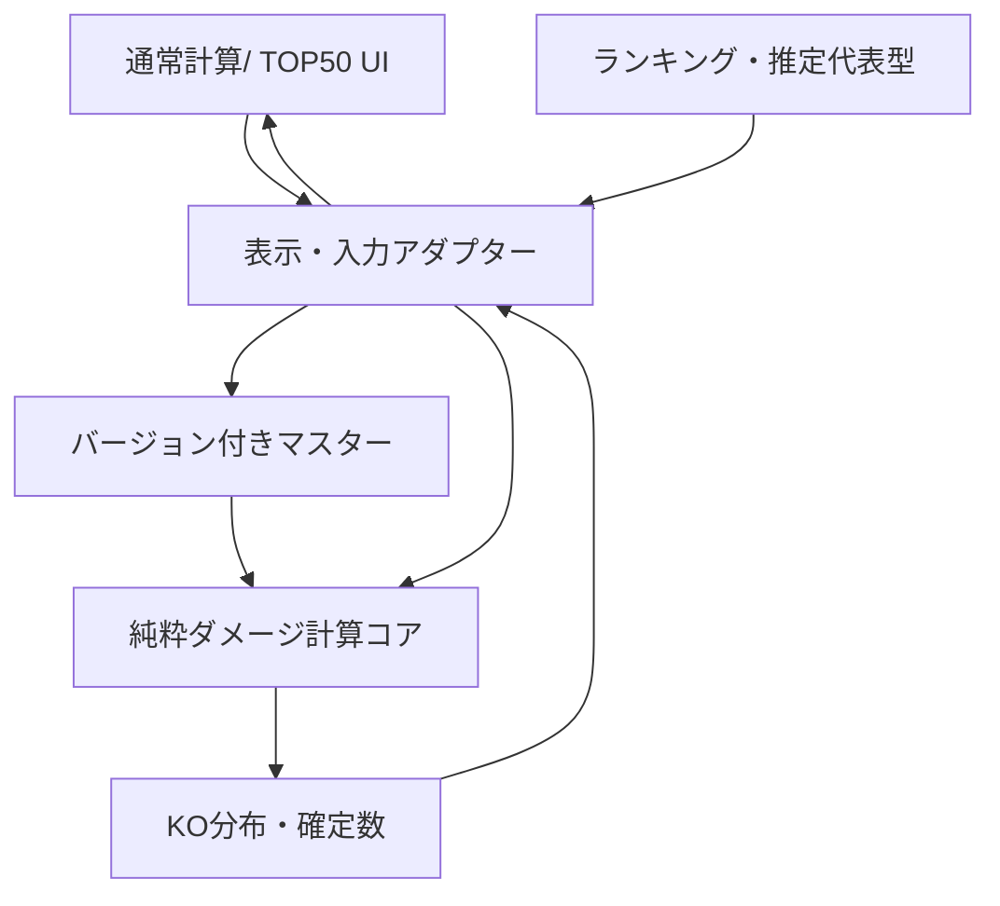

# Codex実装用 境界契約・受け渡し指示（設計資料）v1.2

**本書は実装指示のテンプレートであり、この工程で実装を開始するものではない。**

## 1. 前提資料の優先順位

1. ユーザー承認済みの要求・要件定義、画面設計 v0.5
2. このダメージ計算エンジン詳細設計 v1.2 と検証仕様
3. API／DB設計、技術選定ADR v1.1
4. 試作用エンジンv1.1（**参考コードであって仕様の最終正解ではない**）
5. 参照Wikiや外部統計（レギュレーション・出典・日時と照合）

相互に矛盾する場合、まず「設計差分」を報告し、既存コードを正として他を上書きしない。

## 2. Codexが守る制約

- Next.js/UIと、計算ロジックを独立させ、1個の共通コアで通常・TOP50を処理する。
- **未検証・未実装の効果は省略して数値を返さない**。`unsupported`/`missingContext`を返す。
- ユーザーが入力した技は習得外でもマスターに存在すれば計算対象。ただし特性は当該ポケモンから選択、アイテム自由入力は登録ID解決が必須。
- 全6能力ポイント・性格倍率を内部保持し、UIでは用途に応じて必要な項目だけ表示する。
- TOP50の推定代表型は**実測最多採用型と明示的に区別**。
- TOP50詳細の**技・戦闘条件は閉じたら破棄**、型変更だけ持続。「通常計算へ」では一時条件も引き継ぐ。
- レギュレーションと計算ルール・マスター版を保存/共有データに含める。
- プロトタイプの計算結果を、ゲーム内検証済みの結果として見せない。

## 3. レイヤー間のデータ流れ



## 4. リポジトリ上の設計配置（案）

```text
docs/
  requirements/
  ux/
  architecture/
  api-and-db/
  damage-engine/
    damage-engine-detailed-design-v1.2.md
    verification-and-test-spec-v1.2.md
    effects-catalog-v1.2.md
    codex-implementation-contract-v1.2.md
  decisions/
```

実際のフォルダ名は最終的な設計一式統合時に統一する。過去の設計資料は版と更新理由を残して履歴管理する。

## 5. 後続設計とのインターフェース約束

### コンポーネント設計へ

- `AttackEditor` / `DefenderEditor` / `MoveComboBox` / `AbilityComboBox` / `ItemComboBox` / `CombatConditionsEditor` / `DamageResultDisplay` / `Top50ResultGrid` / `Top50Detail` の責務を明示する。
- 物理/特殊の技に応じて欄が切り替わっても、内部ステートは消さない。
- リクエスト整合性、非同期計算中の旧入力との取り違えを防ぐためにfingerprintを持つ。
- 詳細ローカル条件は`Top50Detail`内スナップショットを使用し、画面外へ漏れない。

### API・DB設計へ

- 公開データ（マスター/ランキング）と非公開データ（個人保存）を分離する。
- 共有URLは秘密情報を含めず、保存時点の計算条件・ルール版・データ版を再現する。
- 外部統計で作った型は実測／推定を区別し、出典・推定アルゴリズム版を保持する。

## 6. 本番実装に進む前のゲート

- [ ] ダメージ計算のP0未検証ルールの扱いを確定する。
- [ ] 技・特性・持ち物の収録全件に対し分類・効果IDの監査方針を完成させる。
- [ ] コンポーネント設計書を完成させる。
- [ ] API・連携設計書を完成させる。
- [ ] DB設計の差分を統合し、アクセス制御・保存/共有を最終確認する。
- [ ] 既存資料の矛盾を解消した「設計統合版・Codex受け渡しパック」を作る。

## 7. 現在の工程

- 完了扱い: 主要要求定義、主要要件定義、UI v0.5、技術スタックの第一候補、基本アーキテクチャ。
- 今回: ダメージ計算**詳細設計**（本書と関連資料。実装はしない）。
- 次回候補: **Reactコンポーネント設計と状態管理設計**。
- その次: API・データ連携詳細設計、DB最終統合、設計一式レビュー。
