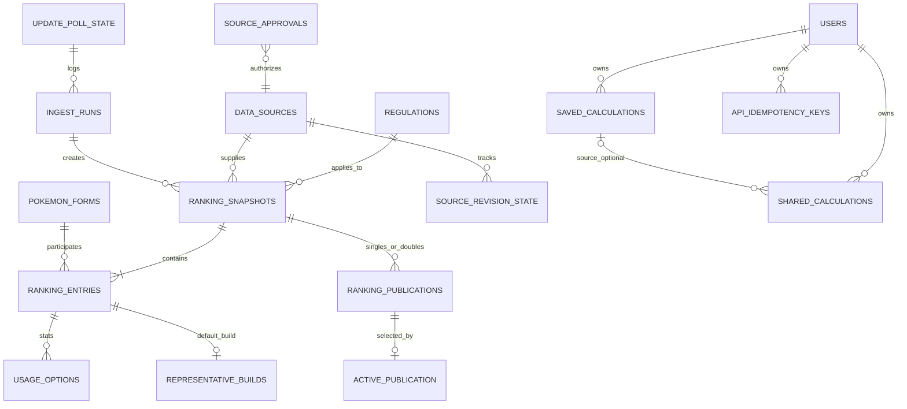
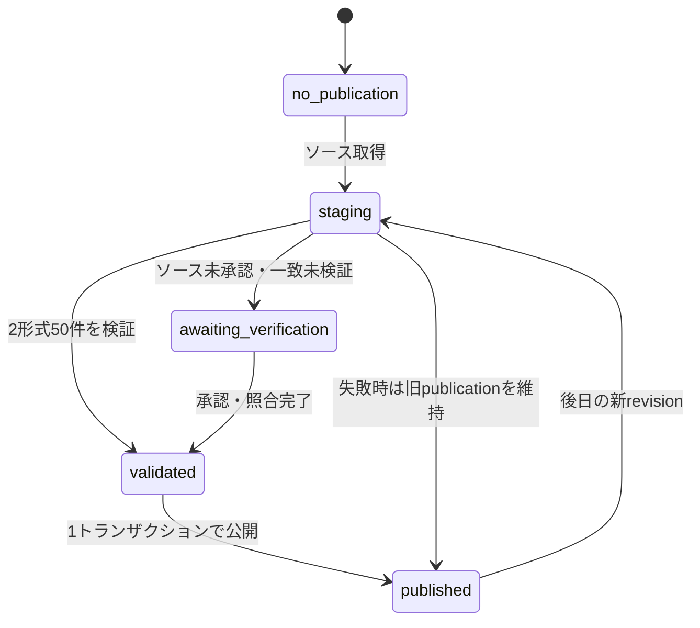

# Pokémon Champions ダメージ計算アプリ — データベース最終統合設計 v1.2

- 作成日：2026-10-23
- フェーズ：**設計のみ**。Supabaseの構築、DDL適用、実DBテストは未実施。
- 根拠：要求定義 v0.2、要件定義 v0.3、確定UI v0.5、状態管理 v1.0、API・データ連携 v1.0、更新ポリシー v1.2。
- 位置づけ：**実装用の統合DB仕様の正本**。旧`202610230001_initial_schema.sql`と`202610230002_rank_verification.sql`を、そのまま順に本番適用してはいけない。Codexは本書から統合した新規baseline migrationを作成する。
- 状態：構造・データフローは確定案。ゲーム内順位の検証、データ利用権利、共有期限、認証方式、性格補正の合法性などの未決定事項は別途ゲート管理。

## 1. 基本方針

1. UIとダメージ計算は共通エンジンを使用し、**DBにダメージ計算結果を保存しない**。DBはマスター参照、使用率・代表型、入力設定、出典と更新履歴を持つ。
2. TOP50はシングルとダブルの**2件の不変スナップショット**を**一つの公開世代（publication）**として公開する。読み取り中の世代混在は許さない。
3. 使用率の順位と代表型の根拠を追跡する。カテゴリー別採用率を寄せ集めた型は`estimated`（推定代表型）であり、`observed`（実測最多組合せ）にしない。
4. 保存・共有には入力スナップショットとルール/マスター/ランキングの識別情報のみを保存し、ユーザー識別子や別データを共有ペイロードに混ぜない。
5. APIで値を検証し、DB制約で不変条件を守り、GRANTとRLSで利用者単位の権限を制限する。
6. 外部提供データの保存期間は提供元の利用許諾に従う。無期限の再配布・ミラーを前提としない。

## 2. 主要エンティティとリレーション

`USERS`は`auth.users`の参照。`RANKING_PUBLICATIONS`は2つの形式のスナップショットIDを保持するため、ER図の線は論理上の関係を省略表現している。

## 3. テーブル設計（統合後の論理仕様）

### 3.1 基本マスター

| テーブル | 主キー | 主な項目・制約 | 公開範囲 |
|---|---|---|---|
| `regulations` | `id text` | 名称、有効期間、Champions対応範囲 | 読取専用 |
| `catalog_versions` **新規** | `id text` | `manifest_hash`, `rule_version`, `effect_catalog_version`, `released_at`, `availability_status` | 公開メタのみ |
| `pokemon_forms` | `id text` | 図鑑番号とは別のフォーム固有ID、タイプ、6種族値、`master_version` | 読取専用 |
| `moves` | `id text` | 技名、分類、タイプ、威力、対象、特殊効果、`master_version` | 読取専用 |
| `abilities`, `items` | `id text` | 名前、効果、`master_version` | 読取専用 |
| `pokemon_abilities` | `(pokemon_id, ability_id)` | そのポケモンの所持特性のみ | 読取専用 |
| `pokemon_learnsets` | `(pokemon_id,move_id,regulation_id)` | メニュー表示する習得技をChampionsの規定に限定 | 読取専用 |

**不変のルール**：ポケモンのフォームIDは「図鑑番号だけ」「表示名だけ」で同定しない。マスターIDは名前変更に影響されない。属性値が変わり得るので、過去データ再現は`catalog_versions`に記録された**不変の版付きアセット**により保証する。現行テーブルに`master_version`列があっても、ID上書きでは過去の種族値・習得技を再現できない。配信・保持できない旧版では `VERSION_INCOMPATIBLE` を返す。

### 3.2 出典・ランキング・代表型

| テーブル | 主キー | 主な項目・制約 | 説明 |
|---|---|---|---|
| `data_sources` | `id text` | 名称、URL、規約URL、帰属表示 | 出典情報 |
| `source_pokemon_ids` | `(source_id, external_id)` | `pokemon_id` FK、フォルム同定、確認情報 | 外部ID↔内部フォームID |
| `source_approvals` **新規** | `id uuid` | ソース・形式・ルール指紋、確認証跡、承認日、失効日 | ランキング定義の継続承認 |
| `ranking_snapshots` | `id uuid` | `format`, `regulation_id`, `source_id`, `source_revision`, `content_hash`, `generated_at`, `published_at_upstream`, `fetched_at`, `verification_status`, `state` | 形式別・不変の世代 |
| `ranking_entries` | `(snapshot_id,rank)` | `rank`1〜50、`pokemon_id`、`usage_rate`（不明はNULL） | 50匹×形式 |
| `usage_options` | `id bigint` | `(snapshot_id,pokemon_id)`参照、`category`, `option_rank`, `option_value JSONB`, `usage_rate` | 個別採用統計 |
| `representative_builds` | `(snapshot_id,pokemon_id)` | 型の6能力ポイント、性格、特性、持ち物、`build_kind`, `algorithm_version`, 根拠JSON | 初期型 |
| `ranking_publications` **新規** | `id uuid` | `singles_snapshot_id`, `doubles_snapshot_id`, `regulation_id`, `ingest_run_id`, `published_at` | 2形式の原子的公開版 |
| `active_publication` **新規** | `singleton_id=1` | `publication_id`, `switched_at` | **唯一の公開ポインタ** |

- `ranking_entries`は1スナップショット当たり1〜50位を重複なしで保持し、公開関数で**ちょうど50件、1〜50の完全連続**を検証する。
- 同じ`(snapshot_id,pokemon_id)`を重複登録しない。形態を別ランキング項目として扱うかは提供元の集計定義で判定し、別フォームIDを維持する。
- `usage_rate`は0〜1の正規化値。元データが百分率なら取り込み時に変換し、0と不明NULLを区別。
- `representative_builds`の能力ポイントは各0〜32、合計66以下、性格倍率・特性・持ち物の適法性は共通ルールで検証。未取得値を0や確定値として捏造しない。
- `build_kind`: `observed`は**組合せ全体の頻度が実測で確認できる場合のみ**。カテゴリー別上位の結合は`estimated`。欠落した場合`incomplete`＋警告。
- APIへ渡す`buildOrigin`は `observed→measured`、`estimated→estimated`、`incomplete→incomplete`の固定マッピング。
- 一般公開APIで`rankingEntryId = snapshot_id || ':r' || rank`を決定的に生成する。上書きキーはこのIDを使用（順位だけではない）。

### 3.3 毎時更新・検知状態

| テーブル | 主キー | 主な項目・制約 | 説明 |
|---|---|---|---|
| `update_poll_state` **新規** | `pipeline_id text` | `last_checked_at`, `last_successful_import_at`, `last_successful_import_jst_date`, `active_source_revision`, `pending_source_revision`, `pending_first_seen_at`, `pending_upstream_published_at`, `last_error_code`, `last_error_at` | シングル＋ダブルの統合パイプライン状態 |
| `source_revision_state` **新規** | `(pipeline_id,format)` | `etag`, `last_modified`, `revision`, `generated_at`, `last_probe_at`, `last_full_fetch_at` | ソース別の軽量変更検知 |
| `ingest_runs` **改訂** | `id uuid` | `pipeline_id`, `scheduled_at`, `started_at`, `finished_at`, `result`, `pair_revision`, `error_code`, `diagnostics` | **毎時の各試行を記録** |

重要な変更：旧`ingest_runs.scheduled_for_jst date UNIQUE`は廃止。これが残ると1時間に1回の試行履歴を保存できない。1日1回の停止判定は`update_poll_state.last_successful_import_jst_date`で行う。

`result`: `skipped_today`, `unchanged`, `pending_delay`, `awaiting_verification`, `published`, `failed`, `busy`。更新検知のみの成功や同じ版の再取得を「本日の取り込み成功」としない。更新ジョブの権限と`source_approvals`は内部に限定する。

### 3.4 ユーザー・保存・共有

| テーブル | 主キー | 主な項目・制約 | 説明 |
|---|---|---|---|
| `saved_calculations` | `id uuid` | `owner_id`, `title`, `mode`, `payload_schema_version`, `calculation_payload JSONB`, `revision`, `created_at`, `updated_at` | 通常計算/TOP50の入力保存 |
| `shared_calculations` | `id uuid` | `owner_id`, `token_hash`, `source_calculation_id NULL可`, `payload_schema_version`, `share_payload JSONB`, `expires_at`, `revoked_at` | 読取専用共有スナップショット |
| `api_idempotency_keys` **新規** | `(owner_id,operation,idempotency_key)` | `request_hash`, `encrypted_response`, `created_at`, `expires_at` | POST再送による二重作成防止 |

- 認証の正本は`auth.users`。アカウント本体・秘密の認証資格情報を自前DBに再実装しない。
- JSONの正本は`payloadSchemaVersion: number`を持つ`SavedInputSnapshot`。**エンジン由来のダメージ値、撃破確率、表示用タブ、詳細ローカル条件は保存しない。**
- TOP50保存には`rankingSnapshotId`と`defenderOverrides`の確定型のみ。新スナップショットへoverrideを黙って引き継がない。
- JSON上限は250,000バイト以下（APIのUTF-8バイト長とDBの判定を揃える）。JSONB列のみの検証では意味的な合法性を保証しないのでサーバー側スキーマ検証必須。
- `revision`はDBのUPDATEトリガーで**1回だけ**増加。更新時に`WHERE owner_id=? AND id=? AND revision=?`で楽観ロック。
- `shared_calculations`のtokenはCSPRNGで生成、DBにはSHA-256ハッシュのみ。GETは最小DTO、共有受信者は元データを更新できない。
- 共有リンク作成のIdempotency Keyに同じレスポンスを返す必要がある場合、短期暗号化レコードでトークンを復元し、期限経過後は明示エラーにする。**平文トークンを長期保存しない。**

## 4. TOP50の状態遷移

### 公開関数の必須契約

`publish_rankings(singles_snapshot_id, doubles_snapshot_id, ingest_run_id)`：管理ロール専用。**同一トランザクション**で以下を検証する。

1. format=`singles`,`doubles`に一致すること。
2. 両方が50件・1〜50連続で、フォームID等が解決していること。
3. 有効なレギュレーションと出典があり、混在を許さない統計定義/世代の条件を満たすこと。
4. 代表型の不足を`incomplete`と記録済みであり、無言の自動補完がないこと。
5. 公開に必要な承認が揃うこと（運用上の**厳格なゲーム内順位一致判定**は別途人が確認するまで未確定。末尾参照）。
6. 新版の`ranking_publications`行を作成し、`active_publication`のsingleton pointerを置換し、更新成功日時とJST日付を**同じトランザクションで**書く。
7. エラーなら全体ロールバック。既存公開版は維持。

読取APIは`active_publication`を**一つのDBスナップショット**で読み、選択されたシングル・ダブルの50件をその公開版に紐付けて返す。別クエリで各形式の最新だけを読まない。

## 5. バージョン、保持、削除

- `source_revision`：上流JSON/公開コミットの識別子。`generated_at`（生成時刻）、`published_at_upstream`（上流公開時刻）、`fetched_at`（こちらの取得時刻）は別々。生成時刻は公開時刻と同義ではない。
- `content_hash`：正規化済みペイロードの整合性識別。元のGitHub SHAも別途記録。
- `catalog_versions`と`sourceVersions`：ルール・マスター・特殊効果の版をリンクする。古い版を保持できなければ無言で更新した版に変更せず`VERSION_INCOMPATIBLE`を返す。
- 外部統計のraw全文を永続保存しない。保持期限や再利用はソース規約の確認後に決定。削除する場合は共有・保存の再現可能性に関するUI表示も変更する。
- 共有の有効期限も未承認事項。永久保持を想定せず、**参照統計の保持期間と共有再現可能な期間を整合**させる。

## 6. 統合する際の差分・注意

- `active_rankings`（旧形式別2行）は廃止。必要な場合は読取互換ビューのみ、新公開処理の真実のソースにはしない。
- `ingest_runs`の1日1回UNIQUEは廃止。毎時チェックが記録できるようにする。
- 旧`guard_active_ranking_source()`は`active_publication`発行関数の検証へ統合する。旧トリガーを放置して新ポインタに適用しない。
- マスター表の`master_version`は単独では過去再現を保証しないため`catalog_versions`と不変アセットを設ける。
- 同じ`source_id,external_id`がシーズン/フォーム違いで曖昧になる場合は`source_pokemon_ids`のキーを`(source_id,source_namespace,external_id)`に拡張し、曖昧な場合は未解決として公開を止める。
- `source_approvals`と`rank_verification`は異なる。**提供元の定義承認≠毎日のゲーム本体順位の実測一致**。UIでゲーム内完全一致を保証する表現は、照合証跡なしで使わない。

## 7. 未決定事項（Codexが独断で補完してはならない）

- **G-01:** メインソースの実際の順位がゲーム内バトルデータと一致するか。自動公開可否と表示ラベルを最終承認する必要がある。
- **G-02:** 外部APIの長期保存・再配布/派生型の保存可能範囲、期間。提供元利用条件の確認が必要。
- **G-03:** 共有リンクの有効期限と、元データが削除された際の再現モード。
- **G-04:** 認証手段（Google、メール等）。Supabase Authの利用のみ決定済み。
- **G-05:** 性格倍率UI（0.9/1.0/1.1）と実際に成立する性格補正ベクトルの変換規則。

設計が完了しても、これらは**本番公開・自動実装のゲート**に残す。決まっていない仕様をコードで勝手に確定しないこと。
