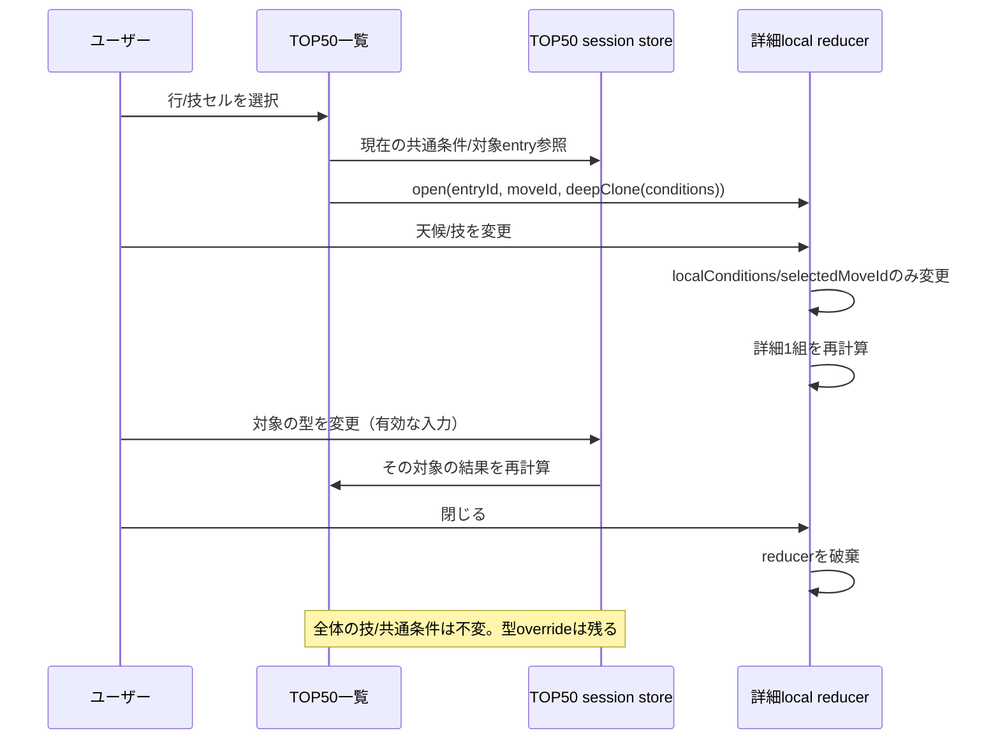
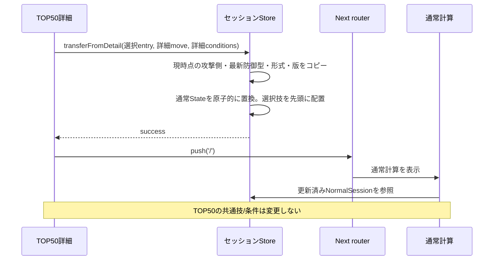

# Pokémon Champions — React状態管理・データフロー詳細設計 v1.0

- 作成日: 2026-10-23
- フェーズ: **設計のみ**
- 正: UI v0.5 / 要件定義 v0.3 / エンジン詳細設計 v1.2
- 目的: CodexがUIと保存・共有を実装する際に、stateの所有者・寿命・更新責務を誤らないための契約

## 1. 採用方針と選定理由

**採用:** ReactローカルState（`useReducer`/`useState`）＋ **ProviderスコープのZustand Store** ＋ 外部データ取得用の独立した取得層。

比較:

| 方式 | 長所 | 今回の課題・結論 |
|---|---|---|
| ローカル`useState`のみ | シンプル、画面内には十分 | モード間の設定転写やセッション保持でpropsの引き回しが増える |
| Context + `useReducer` | React標準のみで実装可能 | 200組結果と50個体の個別変更を同一Contextに載せると再描画を細かく制御しにくい |
| **Zustand + local reducer** | 必要部分だけ購読・選択、モード間の原子的な転写が容易 | **採用**。モジュール単位の単純なglobal singletonはNextのSSRと共存させない |
| Redux Toolkit | ロギング・厳格な状態遷移に強い | 初期アプリ規模では定義が多くなりすぎる |
| TanStack Query | サーバー取得・再取得・失敗処理に強い | **サーバー状態に限定して必要なら採用**。フォーム編集状態の代替にしない |

ZustandはStore factoryで作成し、`CalculationSessionProvider`内の`useRef`でセッションごとのStoreを保持。Server Componentsでは読み書きしない。Server→Client初期DTOとクライアント初期Stateの一致を保証する。`zustand.persist(localStorage)`による無条件の自動永続化はしない。

## 2. 状態を6分類する

| 分類 | データ | 所有者 | 寿命・永続化 |
|---|---|---|---|
| ① 共通読み取りデータ | マスター、対応技、ルール版、公開ランキング | Server取得層＋取得キャッシュ | 外部データ版ごと。ユーザー編集不可 |
| ② 通常計算の入力 | 攻撃・防御、最大4技、戦闘条件、形式 | `normal` slice | ブラウザセッション中。ユーザー操作で明示保存 |
| ③ TOP50の入力 | 攻撃側、4技、共通条件、形式、snapshot ID、個体別override | `top50` slice | ブラウザセッション中。明示保存可能 |
| ④ TOP50詳細の一時入力 | 選択技、詳細専用戦闘条件、無効な編集中テキスト | `Top50DetailSheet`のlocal reducer | 開いている間だけ。閉じたら破棄 |
| ⑤ 表示用UI状態 | 技タブ、検索、ソート、フィルター、パネル開閉 | local state（必要ならUI slice） | 基本的に画面内のみ。計算条件とは分離 |
| ⑥ 保存済み・共有済みデータ | アカウント保存、共有スナップショット | Supabase + API取得層 | 永続。認可・バージョン管理あり |

**禁則:** 計算結果のダメージ値、HPバー%や表示用の`乱数n発(xx%)`を「入力ソース」としてStoreに保存しない。すべてエンジン結果から導出し、ルール/マスター/統計の版を記録する。

## 3. 用語とID

- `pokemonFormId`: マスター上の不変ID。名前・図鑑番号だけで区別しない。
- `rankingSnapshotId`: ソース・形式・集計日時・検証状態を含む不変スナップショットID。
- `rankingEntryId`: そのスナップショットのランキング1行に割り当てられた不変ID。**`defenderOverrides`のキーはこれ**（順位/名前をキーにしない）。
- `ruleVersion`, `masterDataVersion`, `regulationId`: 同一条件の再現性を保証する版。
- `selectedMoveIndex`: PCはクリックした列、スマホは固定技タブの選択値。詳細を開く時に**その時点のmoveIdをコピー**。

## 4. TypeScript状態の契約（参考）

実際の型宣言案は`contracts/frontend-state.reference.ts`に収録。ここでは構造と意味を説明する。

### 4.1 基本入力

```ts
type Stat = 'hp'|'attack'|'defense'|'spAttack'|'spDefense'|'speed';
type NatureFactor = 0.9 | 1 | 1.1;
type BuildSource = 'measured' | 'estimated' | 'custom' | 'manual';
interface PokemonBuildDraft {
  pokemonFormId: string;
  abilityId: string | null;
  item: { kind: 'known'; itemId: string } | { kind: 'customText'; text: string } | { kind: 'none' };
  statPoints: Record<Stat, number>;
  natureFactors: Record<Exclude<Stat, 'hp'>, NatureFactor>;
  currentHp: number | null;
  stages: Partial<Record<Exclude<Stat, 'hp'>, number>>;
  // full build: form/status/mega and any dynamic-move supporting stats/context
  validity: 'valid' | 'invalidDraft' | 'requiresContext';
}
```

設計上`?`はUI表示値。ポイント自体を`'?'`に置換しない。実数値入力の逆算が失敗したら、UIに「実数値入力中/解決不能」のドラフトを持たせ、対応する計算リクエストを`invalid`にする。直前の正常な入力値から黙って計算しない。

### 4.2 通常画面とTOP50画面

```ts
interface NormalSession {
  format: 'singles' | 'doubles';
  attacker: PokemonBuildDraft;
  defender: PokemonBuildDraft;
  moves: readonly string[]; // 1..4件、既知のmoveId
  conditions: BattleContextDraft;
  sourceVersions: VersionTuple;
  revision: number;
}
interface Top50Session {
  format: 'singles' | 'doubles';
  rankingSnapshotId: string | null;
  attacker: PokemonBuildDraft;
  moves: readonly string[];
  conditions: BattleContextDraft;
  defenderOverrides: Record<string, PokemonBuildDraft>; // rankingEntryId -> custom build
  sourceVersions: VersionTuple;
  revision: number;
}
interface Top50Workspace {
  activeFormat: 'singles' | 'doubles';
  sessions: Partial<Record<'singles'|'doubles', Top50Session>>;
}
interface Top50DetailDraft {
  sessionId: string;
  rankingEntryId: string;
  openedFromMoveId: string;
  selectedMoveId: string;  // 詳細だけ
  localConditions: BattleContextDraft; // 詳細だけ
  openedAtTop50Revision: number;
}
```

`Top50Workspace`はシングル・ダブルで**別々の編集中sessionを保持**し、形式変更時に相手形式の設定を取り込まない。切り替えて戻った場合は元の形式の編集中設定を復帰する。`Top50DetailDraft`は`top50` sliceに置かない。ユーザーが詳細を開く都度作成し、閉じると必ず消す。`selectedMoveId`と`localConditions`のみlocal reducerが変更する。対象の`PokemonBuildDraft`は最新の`defenderOverrides[rankingEntryId]`（未編集ならsnapshot代表型）を参照する。

## 5. 状態遷移の決定表

| イベント | `normal` | `top50` | `detailDraft` | 再計算対象 |
|---|---|---|---|---|
| 通常画面で攻撃側を変更 | 攻撃側を更新 | 不変 | — | 通常1〜4技 |
| 通常画面で攻守入れ替え | 両Build交換、技を新攻撃側に合わせ初期化、戦闘条件保持 | 不変 | — | 通常1〜4技 |
| TOP50で4技を変更 | 不変 | `moves`更新 | 開いていれば変えない/古い由来を表示 | TOP50該当技×50匹 |
| TOP50で共通天候を変更 | 不変 | `conditions`更新 | すでに開いていればコピー済み値を維持 | TOP50×全技 |
| TOP50で対象個体の型を編集 | 不変 | **その`rankingEntryId`のoverride更新** | その個体なら結果は自動更新 | 対象個体×全技 + 詳細 |
| 詳細で技変更 | 不変 | 不変 | `selectedMoveId`のみ変更 | 詳細1組のみ |
| 詳細で条件変更 | 不変 | 不変 | `localConditions`のみ変更 | 詳細1組のみ |
| 詳細を閉じる | 不変 | 型overrideのみ残る | **破棄** | 一覧（override反映済み） |
| 詳細から通常計算へ | `attacker`、`defender`、形式、技、**詳細条件**を一括上書き | 不変 | 転写後に破棄 | 通常1〜4技 |
| TOP50をシングル⇄ダブル切替 | 不変 | 対応する形式の`Top50Session`へ切替（なければsnapshotをロード）。その形式のoverrideのみ使用し、異なる形式へ転用しない | 開いていれば一旦閉じる | TOP50全件 |
| 新しいranking snapshotが公開された | 不変 | **現在のsnapshotを自動で差し替えない** | 開いていれば現snapshotのまま | ユーザーが更新承認後に再計算 |

### 5.1 詳細: 開く→編集→閉じる



### 5.2 詳細→通常計算に引き継ぐ



**通常計算の技セット転写の明確化:** 詳細で選んだ技を1スロット目とし、TOP50で選択していた他の技を元の順序で最大3件補完する。重複するmoveIdは二重に追加しない（重複許容が後日要件となった場合のみ変更）。習得外の技も既知IDなら維持する。ダメージのない変化技は`nonDamaging`として表示する。

**通常計算画面での元の入力の扱い:** 上記ボタン操作は、現在の通常計算セッションを置き換える**明示的ユーザー操作**として扱う。元の通常計算の内容を保全する必要がある場合は保存機能を利用する。黙ってマージしない。

### 5.3 型編集の確定タイミング

- `StatPointsAndActualInput`の数値が合法になり、値が確定したタイミング（ステッパー/Enter/blur）で`setDefenderOverride`を呼ぶ。合法な編集は詳細を閉じても残る。
- 逆算できない実数値など、**不正な編集中値は詳細local draftに留め、グローバルなoverrideへは書き込まない**。UIに`?`と修正説明を表示し、その詳細の計算は停止する。
- 不正な編集中値が残っている場合の閉じ操作は「未確定の入力は破棄されます」というメッセージを出す。正常に確定している他の型編集は維持。
- `代表型に戻す`は該当`rankingEntryId`のoverrideを**削除**（統計・推定データ自体は変更しない）。

### 5.4 ソース更新とsnapshotの寿命

- TOP50は読み込み時点のスナップショットをセッションに固定し、9:30更新でバックグラウンドに差し替えない。`新しいランキングがあります`→ユーザーが切り替える。
- 切り替え時は旧`defenderOverrides`を黙って新snapshotへ引き継がない。手動引き継ぎが必要なら**フォームID照合＋明示確認**の別操作とする（初期実装では未提供）。
- 検索/ソート/技タブはランキングIDとは独立のUI状態として保持してよい。ただし選択対象がなくなったら詳細を閉じる。
- 未検証のゲーム内順位データを`verified_ingame`と表示しない。ランキング取得元・集計時刻と取得時刻を区別する。

## 6. 編集UIの重要なルール

### 6.1 能力ポイント・実数値の相互連動

1. ポイント変更 → レベル50のChampions実数値式で即座に再計算。
2. 実数値変更 → `0..32`を探索し、他5能力の配分と合計66を検証する。
3. 候補が複数あるときは、**現在ポイントとの差が最小 → 同距離なら小さい値**。
4. 候補なし → 編集した実数値は保持、ポイント表示は`?`、計算は`invalid`、保存/共有はブロック。
5. 物理/特殊の技切替で非表示になった能力の値を消さない。HPは最大/現在を分けて保持する。
6. 自動能力ランクや実数値更新で他の入力を無言で改変しない（合法性の確認を除く）。

### 6.2 性格補正の注意（実装前に検証する仕様）

UI v0.5は性格**名称を表示せず**、参照する能力の`0.9/1.0/1.1`を選ぶ。内部では統計由来の元の性格/5能力補正を保持する。4技が物理と特殊をまたぐと両方の補正が使われるため、矛盾する複数の`1.1`等を単純に別々の性格として保存しない。

**設計上の暫定ルール:** 現在の完全な補正ベクトルと、選択した能力の倍率が一致する合法な性格候補から、変更する他能力が最少のものを選択する。変更される能力をUIに説明し、以後の技にも適用。候補が一意でない場合の選択優先順位は、**実装前のデータマスター監査で確定**する（Codexの独断で固定しない）。これにより既存推定型の性格IDを可能なら保持する。法的に存在しない補正ベクトルは`invalid`。

### 6.3 コンボボックス

- **ポケモン**: 検索/`▾`、登録フォームIDだけ選択可能。
- **技**: `▾`では選択ポケモンの習得技。文字入力検索では全技マスター中の既知技にも拡大可能。未登録名は計算不可。
- **特性**: そのポケモンの特性だけ（検索時も候補外は禁止）。ポケモン変更で特性が不適合なら、合法候補へ**ユーザーに明示して**リセット。
- **持ち物**: 既知候補は効果を表示。自由文字入力は保持するが、マスター解決ができない場合は`unsupported`として警告。空文字は`none`と区別し、コミット時に正規化。
- **技効果**: 追加効果率は`30%でひるみ`など、データが明示する場合のみ表示。無根拠な確率は埋めない。

## 7. 計算実行と再計算

**入力正規化 → 入力検証 → Master/Rule解決 → 共通エンジン → View Model生成**の順。UIがダメージ値・KO確率を独自計算しない。

- 通常計算: 最大4件。選択技の物理/特殊分類に基づいて攻防の能力値を参照。
- TOP50一覧: 最大4件×50行。`rankingEntryId`ごとの代表型/overrideを合成。全体条件の変化時は該当全件を再計算。
- TOP50詳細: 選んだ1技×その1匹。**詳細local conditions**で計算。対象Buildは最新のoverrideを使う。
- `resultCacheKey`は `ruleVersion + masterDataVersion + regulationId + rankingSnapshotId(該当時) + normalized attacker + defender + moveId + battle conditions + effectCatalogVersion` の正規化指紋から作る。`revision`だけを計算キーにしない。
- 1匹のoverride更新で、他49匹の条件やキャッシュを無効化しない。
- 入力が`invalid`/`missingContext`/`unsupported`なら、**直前の成功結果を最新値として再表示しない**。
- 簡易状態では同期計算で開始し、200組処理が入力操作やアニメーションを妨げる場合だけWorker化。Worker化した場合はrequestId/revision一致時だけ結果を採用。古い結果を破棄する。
- UIの表示（`KoLabel`、HPバー・%）は専用formatter/view-modelにまとめ、画面間で重複実装しない。

## 8. 保存・同期・共有との関係

### 保存

ユーザーが明示的に保存した時点で`normal`または`top50`の**有効な入力スナップショット**をJSON DTOへシリアライズする。TOP50ではカスタム型overrideとsnapshot IDを含む。フィルター、固定技タブ、詳細local技/条件、フォーカス・スクロール位置は保存しない。

能力ポイント・実数値が成立しない`invalidDraft`のまま保存/共有してはいけない。一方、未知の持ち物の**文字列は保存可能**（計算結果は`unsupported`）。保存に失敗したらローカル入力を保持し、失敗理由を表示する。認証が必要ならログインへ誘導し、戻ってきても入力を復元する。

### 同期

- 保存データはSupabaseが正本。編集セッションはユーザーが読み込んだコピー。
- 同時編集に備えて`revision`をAPIへ送付。競合なら無言の上書きを禁止し、再読み込み/複製保存を提示。
- 復元時は`schemaVersion`、`ruleVersion`、`masterDataVersion`、`rankingSnapshotId`を検証。古い版を勝手に最新ルールへ移行しない。

### URL共有

共有時点の入力・バージョンをサーバーに**不変スナップショット**として生成。公開URLには認証トークンやprivate IDを含めない。共有URLを開いて「自分用に編集」すると、コピーをsession Storeへインポートし、元の共有オブジェクトは変更しない。

**例外**: TOP50詳細で「通常計算へ」遷移した後に通常計算を共有する場合、詳細内の技・戦闘条件を取り込んだ`normal`セッションを共有対象とする。

## 9. フォーマット・非対応・数値のUI変換

- 乱数KOは`乱数{hits}発({probability.toFixed(1)}%)`。丸めの境界はエンジン詳細設計の最終ポリシーに合わせる。`3発以上`は絞り込みラベルのみ。
- `nonDamaging`はダメージ欄に`—`。無効技、`missingContext`、`unsupported`、`invalid`は区別した文言と原因コード。
- TOP50のバーは最大HPベースの**攻撃後の残HP割合**。左に残り、右から失う。与ダメージは割合を独立テキストで表示。
- HP色の閾値はUI v0.5準拠。色のみで撃破可否を判断させない。
- 状態異常の追加効果率などはマスター由来。`100%`の表記も許可。

## 10. ルート遷移とセッション保全

### 想定遷移

`/top50`の詳細から通常へは**Storeの`transferToNormal`アクションが成功してから**`router.push('/')`する。同一アプリレイアウトのProviderを保つため、クライアント遷移中に内容が失われない。失敗時は詳細を閉じずにエラーを表示。

- ハードリロード時: アカウント保存済み設定を自動で読み直すとは限らない。URL共有や保存一覧から明示的に復元する。必要なら「未保存の計算ドラフトを復元」の確認UI（将来拡張）。
- URL直アクセス時: `normal`は初期値、`top50`は利用可能な公開snapshotで開始。共有はtoken検証後のスナップショットを読み取る。
- 複数タブ: セッション編集状態はタブごと。DBで保存した設定の競合はrevisionで扱う。

## 11. UX重要ケース（曖昧さを残さない）

1. **詳細の天候を雨に変更→閉じる→再オープン**: TOP50共通条件が晴れなら再び晴れ。一覧は変化なし。
2. **詳細の技を別技に変更→閉じる**: TOP50の4技は変化しない。
3. **詳細の相手HPポイントを変更→閉じる**: TOP50の該当ポケモンにのみ残る。他49匹に影響なし。
4. **詳細で技と雨を変更→通常計算へ**: 通常画面の先頭技と戦闘条件はその値。対象防御型の最新版も引き継ぐ。
5. **TOP50の最新ランキング通知**: 表示中の50件が勝手に切り替わらない。ユーザーの更新承認後に切替。
6. **不可能な実数値入力**: UIには入力値・ポイント`?`と理由。前の正しいダメージを表示しない。
7. **4技に物理と特殊を混在**: Attack/SpAttack、Def/SpDefenseは内部保持・それぞれの技で正しい能力を使用。
8. **持ち物未登録文字列**: 入力文字列は保存・共有してよいが、ダメージは`unsupported`。存在しない効果を仮定しない。
9. **未習得の既知技を文字検索**: 選択は許可し、習得外表示を添える。`▾`の通常一覧には表示しない。
10. **保存済みを別端末で読む**: 版と権限を検証し、読み込み後のSessionへのコピーを明確化。同期中に古い結果が混ざらない。

## 12. 後続工程への受け渡し

- API連携設計: `CatalogDTO`/`RankingSnapshotDTO`/`SavedCalculationDTO`/`SharedCalculationDTO`の取得・更新・認可・エラー契約を明確化。
- DB最終統合: `rankingEntryId`, `revision`, `schemaVersion`, `buildKind`, `sourceVersions`を保持。
- ダメージエンジン: 本書の`PokemonBuildDraft`とエンジン`DamageRequest`をアダプタで変換し、5種の結果statusをUIに渡す。
- Codex: これらを守り、UIモックの仮の計算数値を本番ロジックに利用しない。
