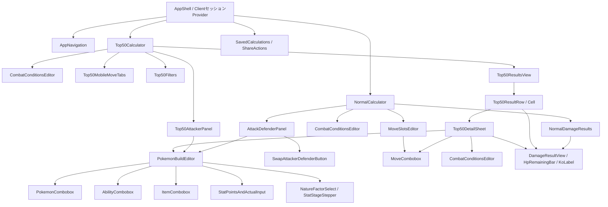

# Pokémon Champions — Reactコンポーネント詳細設計 v1.0

- 作成日: 2026-10-23
- フェーズ: **設計のみ**。実装・GitHubへの書き込みは行わない。
- 対象: Web版（Next.js App Router / React / TypeScript）
- 正とする画面仕様: `screen-design-v0.5.md`, `screen-flow-v0.5.md`
- 関連仕様: 要件定義 v0.3、ダメージエンジン詳細設計 v1.2、ADR v1.1
- ステータス: **コンポーネント構成の設計版確定**。特殊効果・API/DBの未検証事項は別工程。

## 1. 目的・境界

- 通常計算とTOP50が、同じ入力UI/計算UI/検証ルールを使用する。
- PCは密な比較表、スマホはコンパクトな縦一覧＋固定技タブ。同じ機能を別実装で二重管理しない。
- Reactコンポーネントは**計算式・外部APIの詳細を知らない**。UI adapter / hooksを経由する。
- 技・特性・持ち物の「説明」は版管理されたマスターデータから表示。架空の効果率を埋め込まない。
- TOP50の詳細だけの技・戦闘条件を、一覧へ漏らさない。
- 計算できないケースでデモ数値・推測数値を表示しない。

## 2. ルートとServer/Client境界

| パス（設計案） | 主な画面 | 描画・状態 |
|---|---|---|
| `/` | `NormalCalculatorPage` | Server側で版付き初期データ取得 → Clientの`NormalCalculator` |
| `/top50` | `Top50CalculatorPage` | Server側で有効ランキングを取得 → Clientの`Top50Calculator` |
| `/saved` | `SavedCalculationPage` | 認証チェック、保存一覧取得。編集画面への復元はClient action |
| `/shared/[token]` | `SharedCalculationPage` | 公開共有データを権限チェック後に読み込み、閲覧/複製を可能にする |
| `/login` | `SignInPage` | Supabase Auth。ログイン後の未保存入力復元に対応 |
| `/account` | `AccountPage` | ユーザー情報・ログアウト・保存導線 |

`app/(application)/layout.tsx`を共有のセッション境界として`CalculationSessionProvider`を配置し、`/`→`/top50`のクライアント遷移でも編集中データが失われないようにする。Server ComponentがZustand storeへ直接アクセスしてはならない。Server→Clientへ渡すpropsはシリアライズ可能なDTOに限定する。認証・保存データの読み取りにはサーバー側で権限を確認する。

**注意:** OAuth等の外部リダイレクトでブラウザ全体が再読み込みされる場合、Providerのメモリ状態は消える。ログイン前の一時入力を`sessionStorage`の期限付き・版付きドラフトへ待避し、帰還後に検証のうえ復元する。保存データとして無断で永続化はしない。

## 3. コンポーネントツリー



> `Top50DetailSheet`は描画上はDrawer/BottomSheetだが、**別ページへ遷移しない**。計算条件のローカルStateをもつ。

## 4. コンポーネント一覧と責務

### 4.1 レイアウトと画面

| コンポーネント | 責務 | 状態の所有者 |
|---|---|---|
| `AppShell` | ナビゲーション、レスポンシブ共通レイアウト、ユーザー導線 | 認証はサーバー/外部ストア、展開UIはlocal |
| `CalculationSessionProvider` | ブラウザセッション単位でZustand Storeを生成・共有 | session全体 |
| `NormalCalculator` | 攻守ビルド、最大4技、戦闘条件、結果の配置 | `normal` slice |
| `Top50Calculator` | TOP50攻撃側設定と一覧の配置、4技比較 | `top50` slice |
| `SavedCalculations` | 保存一覧・読み込み・削除・複製 | Server state、編集中項目はlocal |
| `ShareActions` | 現在の有効な計算設定から共有スナップショットを作成 | 保存API・表示中フォームへのコールバック |

### 4.2 ポケモン・技・戦闘条件

| コンポーネント | 表示・操作 | 注意 |
|---|---|---|
| `PokemonCombobox` | 入力で絞り込み、右端`▾`ですべての候補、タイプ等の補助情報 | 有効な`pokemonFormId`のみ確定。対象の切替時は関連する特性・技を再検証 |
| `MoveCombobox` | 技のタイプ、分類、威力、効果、追加効果率を候補で表示 | 通常候補は習得技。入力検索時のみ「習得外だがマスターに存在する技」を選択可能 |
| `AbilityCombobox` | **選択中ポケモン固有の特性のみ**を表示、効果説明あり | 自由入力・候補外の確定禁止 |
| `ItemCombobox` | 名前検索、候補の効果、任意文字入力 | 未解決の自由入力は`unsupported`。既知IDに勝手に紐付けない |
| `PokemonBuildEditor` | `role=attacker/defender`によって表示する能力値を切替 | **内部では6能力ポイントと性格補正全体を保持** |
| `StatPointsAndActualInput` | 能力ポイント・実数値・±1ボタンと逆算エラー | 成立しない実数値は値を残し、ポイント欄に`?`、計算無効化 |
| `NatureFactorSelect` | 表示能力の`0.9/1.0/1.1`選択 | 性格名は表示しない。内部の全補正との合法性は要最終ルール確定 |
| `StatStageStepper` | `-6`〜`+6`を1ずつ変更 | 攻撃側は攻撃/特攻、防御側は防御/特防のみを見せる |
| `CombatConditionsEditor` | 天候・フィールド・詳細条件チェックを**戦闘条件内に表示** | `global`/`detail-local`をpropsで区別。コンポーネントは直接Storeを触らない |
| `MoveSlotsEditor` | 最大4技の追加・変更・削除 | 物理/特殊の参照能力を技ごとに切り替え、裏の他能力を消さない |
| `SwapAttackerDefenderButton` | 通常計算で攻撃側/防御側を交換 | 共通戦闘条件は保持。新攻撃側の技スロットはv0.5仕様どおり再初期化 |

**共通Combobox props設計:** `valueId?`, `text`, `options`, `onQueryChange`, `onSelect`, `onInputCommit`, `getLabel`, `getDescription`, `allowFreeText`, `openAllOnChevron`, `ariaLabel`, `disabled`。`Pokemon/Ability`は`allowFreeText=false`、`Move`は「マスターにあるIDのみ」、`Item`は入力文字を保持できる。右端`▾`はマウス/タッチ/キーボードで開く。ARIA comboboxパターン・候補選択時のフォーカス復元が必須。

### 4.3 計算結果とTOP50詳細

| コンポーネント | 責務 | 状態の所有者 |
|---|---|---|
| `DamageResultView` | ダメージ実数・割合・残HPバー・確定数、状態別メッセージ | **表示専用**。計算エンジン出力から導出 |
| `HpRemainingBar` | 左に残HP、右から減る、乱数の幅を重ねる | propsのみ。0%は濃い赤、1-20赤、21-50黄、51-100緑 |
| `KoLabel` | `確定n発` / `乱数n発(XX.X%)` / `無効`等 | propsのみ。`3発以上`は結果表示で使わない |
| `NormalDamageResults` | 1〜4技の結果と各技の詳細を表示 | 派生結果のみ |
| `Top50ResultsView` | 50匹の順位、技ごとの残HPバー、与ダメ割合、確定数の密な一覧 | `top50` sliceから表示用セレクタを読む |
| `Top50ResultRow` | 対象エントリの1行。選択した技セルを詳細へ渡す | propsのみ。`rankingEntryId`を安定キーに使用 |
| `Top50MobileMoveTabs` | 技1〜4を画面内で切替、**スクロール中も固定** | 選択タブはlocal/UI slice、計算条件とは別 |
| `Top50Filters` | 検索・ソート・KO確定数カテゴリ | 一覧表示専用のlocal/UI slice。フィルタ`3発以上`を残す |
| `Top50DetailSheet` | 技・条件を一時編集、型を一覧へ反映、通常計算へ遷移 | `detailDraft`は**useReducer(local)**、型は`top50.defenderOverrides` |
| `Top50DetailTransferButton` | 詳細のすべての設定を通常計算へコピー | 原子的なsession action |

### 4.4 PC・スマホ別配置

- **PC/通常**: 攻守2カラム、4技結果を見渡せる。戦闘条件・チェックボックスは横断領域。
- **スマホ/通常**: 攻守縦並び、結果は縦スクロール。入力コントロールのタップ領域確保。
- **PC/TOP50**: 1行に順位・名前 + **4技のバー・与ダメージ割合・KO表示**。画面幅が不足すれば横スクロールできる表コンテナにする。デスクトップに「対象：技1」は表示しない。
- **スマホ/TOP50**: 攻撃側入力・検索フィルター初期折りたたみ。画面上部の1〜4技固定タブ + 50匹の密な1列リスト。各行は名前・バーと与ダメ割合・KOラベルのみ。
- **詳細/TOP50**: PCは右サイドシート、スマホはボトムシート。単一の`Top50DetailSheet`がレスポンシブに表示形態を切替。移動時にlocalStateがリセットされないよう、開閉・選択先変更のタイミングで明示的に初期化する。

## 5. 画面外状態と表示状態を区別する

`Top50ResultRow`、`HpRemainingBar`、`KoLabel`などの純粋表示コンポーネントはZustandへの直接依存を避け、表示専用propsを受け取る。画面入口のselector/hookで必要な最小データを取り出す。1匹の変更で50件すべてのUIを無用に再描画しない。

`DamageResultView`には`ok / nonDamaging / missingContext / unsupported / invalid`の**判別Union**を渡し、計算不可の場合はバーやKOの架空数値を描画しない。エラー内容・修正できる箇所を表示する。

## 6. コンポーネント境界の例（**型契約であり実装ではない**）

```ts
interface PokemonBuildEditorProps {
  role: 'attacker' | 'defender';
  selectedCategory: 'physical' | 'special';
  build: PokemonBuildDraft;
  onChange(next: PokemonBuildDraft): void;
  catalogVersion: string;
}
interface CombatConditionsEditorProps {
  scope: 'normal' | 'top50-global' | 'top50-detail';
  value: BattleContextDraft;
  onChange(next: BattleContextDraft): void;
}
interface Top50DetailSheetProps {
  entryId: string;
  initialMoveId: string;
  onClose(): void;
  onTransferToNormal(): void;
}
```

具体的な`PokemonBuildDraft`等のデータ構造は`frontend-state-design-v1.0.md`および`contracts/frontend-state.reference.ts`に記載。

## 7. 推奨ディレクトリ構成（設計案）

```text
apps/web/src/
  app/
    (application)/
      layout.tsx
      page.tsx
      top50/page.tsx
      saved/page.tsx
      shared/[token]/page.tsx
    login/page.tsx
  features/
    calculator-normal/{components,hooks}/
    calculator-top50/{components,hooks}/
    pokemon-editor/{components,hooks}/
    battle-conditions/components/
    calculation-results/components/
    saved-calculations/{components,services}/
  components/ui/                 # shadcn/ui + 共通のCombobox部品
  state/{session-store,session-provider,selectors,actions}/
  adapters/{to-engine-request,to-result-view}/
  services/{master-catalog,ranking-repository,account-repository}/
  lib/{formatters,validation,versioning}/
packages/damage-engine/          # 別パッケージ。UIには依存しない
```

`packages/damage-engine`のインターフェースは詳細設計v1.2を優先し、v1.1試作コードは参考とする。`apps/web`からエンジンへ依存するが逆方向の依存は禁止。

## 8. アクセシビリティ・UIテスト観点

1. Comboboxは入力フォーカス/`▾`押下で候補表示、矢印キー/Enter/Escape/外側クリックに対応。
2. 技候補は効果・追加効果率をテキストで読める。範囲技は`範囲技`と表示。
3. 数値の±1ボタンは入力の上限・下限を超えない。
4. モバイル技タブのstickyとボトムシートは画面の安全領域・重なりを検証。
5. Detailの開閉時にフォーカスを適切に移動/復元し、背面への誤操作を防止。
6. HPバーは色だけでなく`残HP`と`与ダメージ%`の文言で理解できる。
7. 表とカードは同じ意味の計算結果を表示。対応できないセルには理由を表示。

## 9. 設計完了条件

- [x] UI v0.5の各要素のコンポーネント責務と再利用範囲を特定。
- [x] 通常・TOP50・詳細の依存方向、表示構成、PC/スマホ差を定義。
- [x] Server/Client境界とProvider配置を定義。
- [x] 計算状態と表示状態の分離方針を確定。
- [ ] 実装時に実データを使ったUIアクセシビリティテストを実施（実装工程）。
